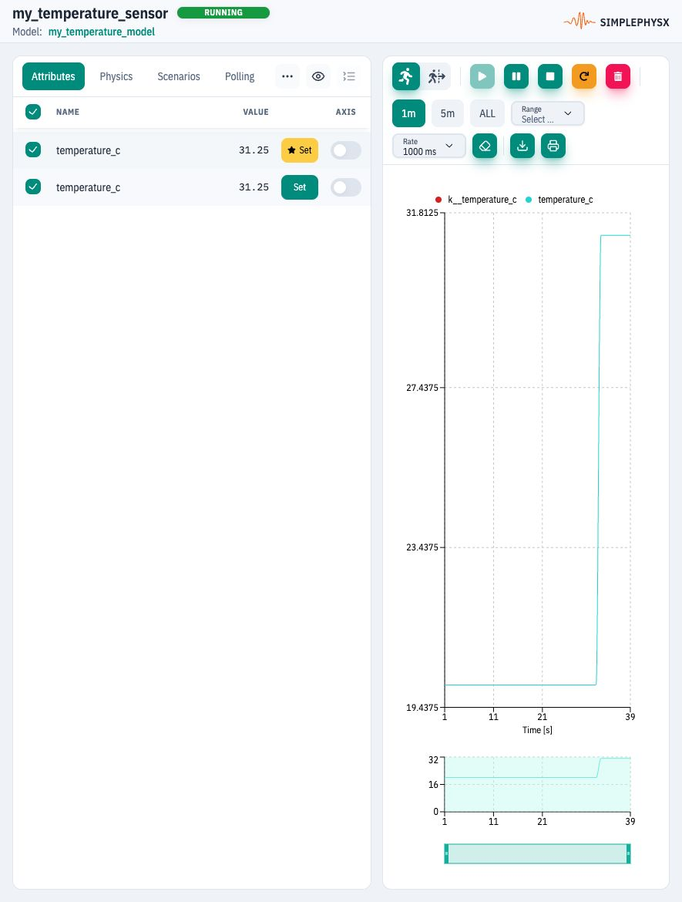

# First device in the UI

## Before you start {#first-device-in-the-ui}

**Prerequisites:** [SPX installed](installation-guide.md), UI open at
`http://localhost:3000`, and a connection to your local server selected in
[Settings](../ui-reference/settings.md).

**Result:** instance `my_temperature_sensor` is **RUNNING**; setting its input to
**31.25°C** produces a telemetry reading of **31.25°C**. No MCP, Python or external
protocol client is needed. This is a simulation exercise, not a hardware check.

For a screenshot-led workflow starting with a ready-made file, follow
[Create and control an instance](../guides/ui-instance.md). The compact exercise
below lets you paste the definition directly.

<figure><figcaption><p>The completion result for this introductory exercise.</p></figcaption></figure>

## Create the model

1. Open **Models** and create a new model. Set the model registry name to
   `my_temperature_model`. Use a different name if that name already exists.
2. Select YAML in the editor and paste the complete definition below.
3. Choose **Save** and check the Validation panel for success.

<!-- model:pt100:start -->
```yaml
name: pt100_demo
description: Minimal deterministic temperature sensor
attributes:
  k__temperature_c:
    type: float
    default: 20.0
    unit: degC
  temperature_c:
    type: float
    default: 20.0
    unit: degC
actions:
  - function: $in(temperature_c)
    name: update_temperature
    call: $in(k__temperature_c)
```
<!-- model:pt100:end -->

The definition's `name` is metadata; the registry name you saved is the model
selected when creating an instance. See [model identifiers](../appendices/glossary-of-terms.md#model-identifiers)
if these names differ in your project.

## Create and start an instance

1. Open **Instances**, choose **New instance**, select `my_temperature_model`
   and enter `my_temperature_sensor` (or another unused name).
2. Create the instance and choose **Start** in Continuous mode.
3. Open its details and confirm **RUNNING**. In **Attributes**, locate
   `k__temperature_c` (input) and `temperature_c` (telemetry).

## Change an input and verify the result

1. Set the **internal value** of `k__temperature_c` to **31.25** and submit the edit.
2. Wait for the next UI refresh. `temperature_c` should read **31.25**.
3. Change the input to **18.0** and confirm telemetry follows to **18.0**.

If the reading does not follow, confirm that the instance is RUNNING and the
input was saved. See the [Instances UI reference](../ui-reference/instances.md)
for the current controls. A successful edit alone is not proof of propagation.

## Finish and continue

Stop `my_temperature_sensor` when finished. On a disposable environment you can
also delete this instance and then `my_temperature_model`; keep unrelated
models and instances intact.

**You have completed the first UI exercise.** Continue with
[the UI guide path](../guides/ui.md), or choose an optional
[protocol walkthrough](choose-a-protocol-adapter.md) to test an external client.
