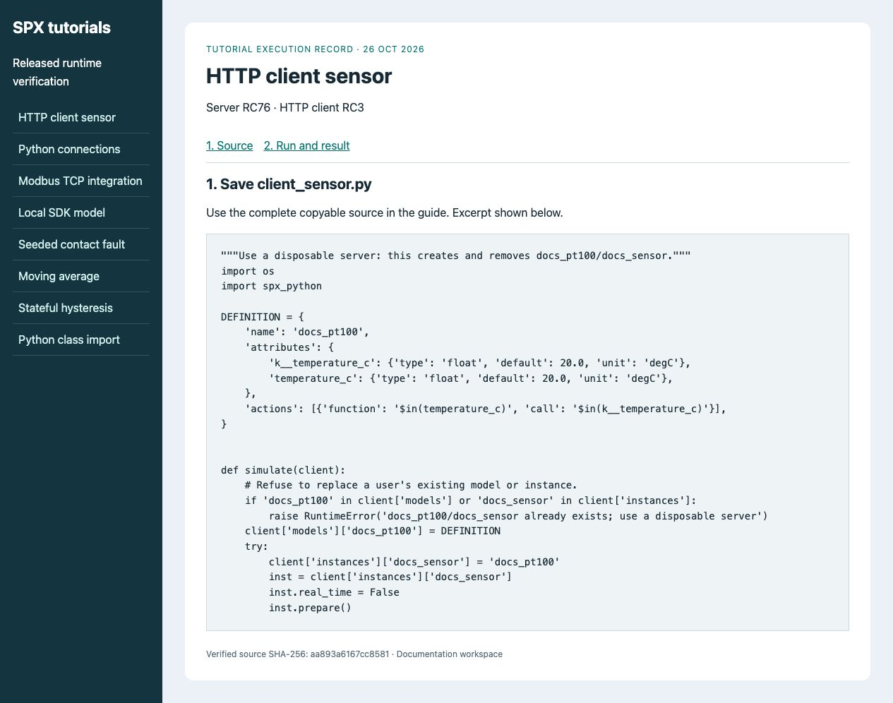
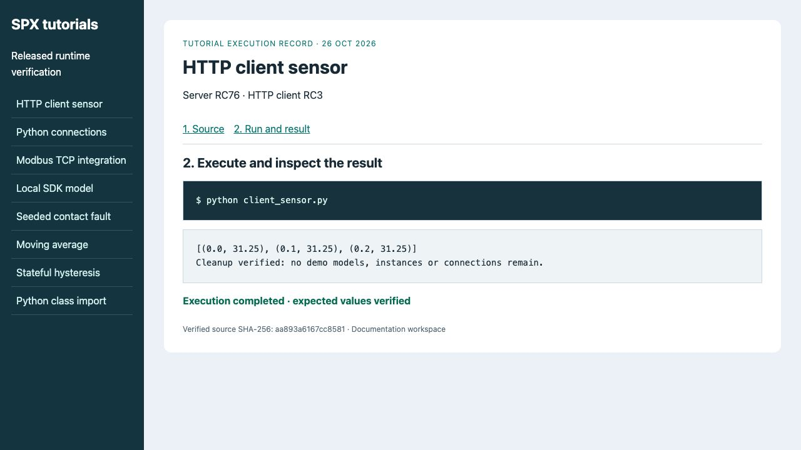

# Create and control a simulation with Python

**Goal:** create a model and instance, apply **31.25°C**, advance the simulation
clock explicitly and read the processed temperature.
**Before you start:** Python 3.12, a disposable SPX Server RC76 and the
[documented versions](../release-notes.md). Start the server using SPX Setup /
SPX Start, or your [manual deployment](manual-docker-compose.md).

The public Examples repository contains models and scripts. It does not contain
the installed product's personalized Compose bundle.

## 1. Prepare the client

In your virtual environment install `spx-python==1.0.0rc3`. Set
`SPX_PRODUCT_KEY` and optionally `SPX_BASE_URL`; the default is
`http://localhost:8000`. Keep the key out of code and screenshots.

For shell-specific environment setup and the full program use
[First Python program](../simulation-and-modeling/using-spx-python.md).
Save that program as **client_sensor.py**.

## 2. Follow the lifecycle

| Program operation | Meaning | Completion check |
| --- | --- | --- |
| Register `docs_pt100` | Store the reusable definition. | Model key exists. |
| Create `docs_sensor` | Create one live device from that definition. | Instance references the model. |
| Set `real_time=False`; Prepare; Start | Use an explicit clock while keeping lifecycle state RUNNING. | No background time progression. |
| Write `k__temperature_c.internal_value` | Change the persistent input. | Input = 31.25. |
| Set `inst['timer'].time`; Run | Process one model cycle at a controlled time. | `temperature_c.external_value` = 31.25. |
| Stop and remove owned resources | Leave unrelated resources untouched. | Demo names are absent. |

<figure><figcaption><p>The complete source is provided in First Python program; this record identifies the script and lifecycle being exercised.</p></figcaption></figure>

## 3. Run and inspect the output

```bash
python client_sensor.py
```

```text
[(0.0, 31.25), (0.1, 31.25), (0.2, 31.25)]
```

<figure><figcaption><p>Three expected samples confirm processing; cleanup removes only the script’s reserved demo model and instance.</p></figcaption></figure>

**Completion:** all three tuples match and cleanup succeeds. This uses a quiet
copy-input model; adding noise would require tolerance-based assertions.
Manual clock control alone does not seed randomness or synchronize a network SUT.

For the same task in the browser use [Create and control an instance](../guides/ui-instance.md).
Next automate [connections](../guides/python-connections.md) or test an external
[Modbus client](use-in-unit-tests-mil.md).
