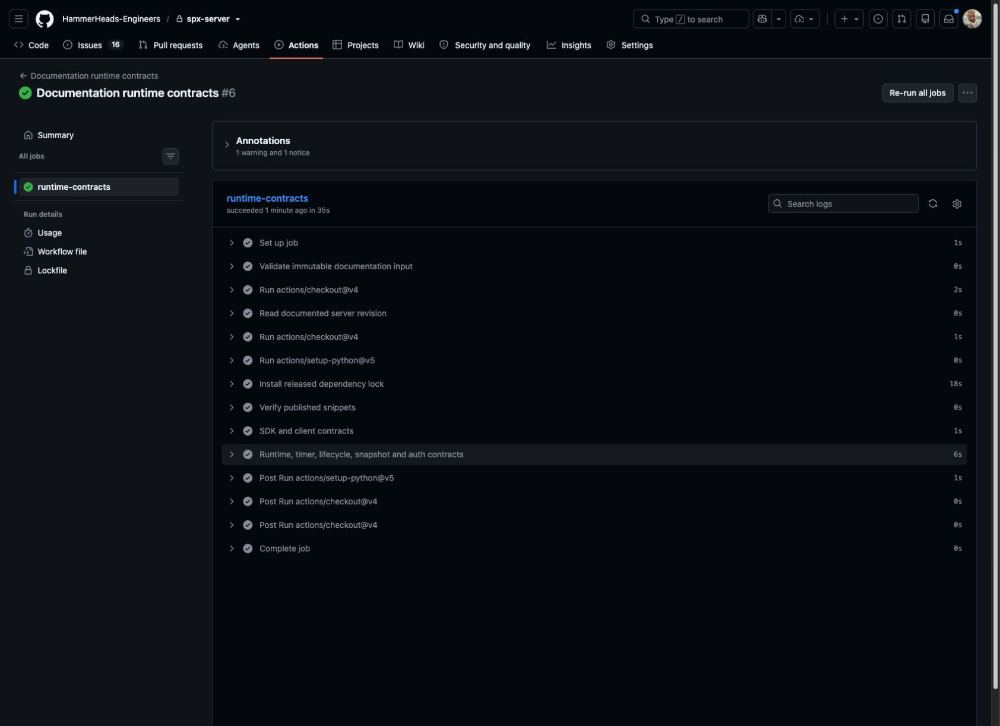

# Run tests in CI

**Goal:** a runner starts a disposable SPX deployment, reads **28°C** and **34°C**
over Modbus, and tears the deployment down even if the test fails.
**Before you start:** complete [Test a client over Modbus](use-in-unit-tests-mil.md)
on your own deployment. Keep `client_sensor.py` and `modbus_test.py` at your
project root. Use the [documented release versions](../release-notes.md).

## 1. Prepare the project

Commit your project-owned Compose definition, pinned server image and test files.
Expose API **8000** and Modbus **15020** from the server container. Provide the
product key using the deployment's existing environment mapping. The public
Examples checkout does not contain your personalized product Compose bundle.

In your GitHub repository open **Settings → Secrets and variables → Actions**
and add **SPX_PRODUCT_KEY**. Do not paste it into a workflow or screenshot.

## 2. Add the workflow

Save the following as **.github/workflows/spx-integration.yml**. Fork pull
requests are skipped because they do not have the trusted runtime credentials.
A skipped job is not a passed protocol test.

<!-- workflow:spx-integration:start -->
```yaml
name: SPX integration
on: [push, pull_request]
permissions:
  contents: read
jobs:
  modbus:
    if: github.event_name != 'pull_request' || github.event.pull_request.head.repo.full_name == github.repository
    runs-on: ubuntu-latest
    env:
      SPX_PRODUCT_KEY: ${{ secrets.SPX_PRODUCT_KEY }}
      SPX_BASE_URL: http://localhost:8000
      SPX_MODBUS_HOST: 127.0.0.1
      SPX_MODBUS_PORT: '15020'
    steps:
      - uses: actions/checkout@v4
      - uses: actions/setup-python@v5
        with:
          python-version: '3.12'
      - name: Install test client
        run: python -m pip install spx-python==1.0.0rc3 modbus-tk==1.1.5
      - name: Start project-owned disposable runtime
        run: |
          test -n "$SPX_PRODUCT_KEY"
          docker compose up -d
      - name: Wait for API readiness
        run: |
          for attempt in {1..20}; do
            if curl -fsS http://localhost:8000/health >/dev/null; then
              exit 0
            fi
            sleep 3
          done
          docker compose logs --no-color --tail=80
          exit 1
      - name: Read actual Modbus TCP values
        run: python modbus_test.py -v
      - name: Stop runtime even after failure
        if: always()
        run: docker compose down
```
<!-- workflow:spx-integration:end -->

<figure><figcaption><p>Copy the complete workflow above into your project. The repository and file path remain visible for context.</p></figcaption></figure>

## 3. Read the run, not just the badge

Commit/push the workflow, then open **Actions → SPX integration → latest run**.
Inspect the setup, readiness, Modbus and teardown steps. The Modbus command
must run and report `test_temperature_readback ... ok` and final `OK`.

The documentation itself also has a **Documentation runtime contracts** check.
It executes the same tutorial functions against the pinned released runtime,
including real loopback Modbus reads. It is separate from the project Compose
recipe above: your image pull, license and container port mapping must be checked
in your own pipeline.

<figure><figcaption><p>A real documentation runtime verification run. Use the same job-and-step inspection in your own SPX integration run.</p></figcaption></figure>

**Completion:** setup, the actual TCP assertions and teardown succeed. API health
alone is not sufficient. If your job is skipped, inspect the triggering event;
if setup fails, inspect image access, deployment configuration and the secret's
presence without printing its value.

## Finish and extend

Keep the always-run teardown. It stops this job's deployment; do not target a
shared server from this introductory workflow. Add your own SUT assertions after
the two known-value reads work. See [Testing practices](../testing-and-validation.md)
for timing, tolerances and controlled inputs.
