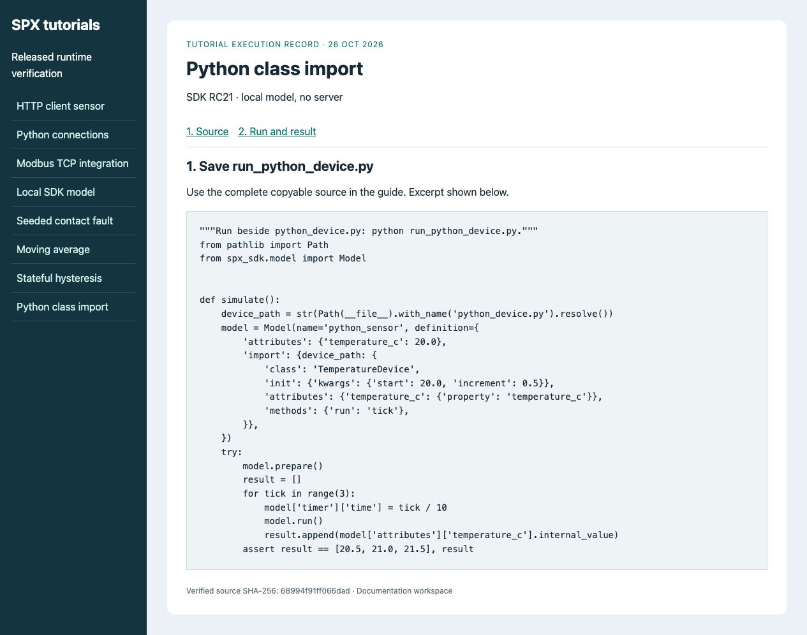
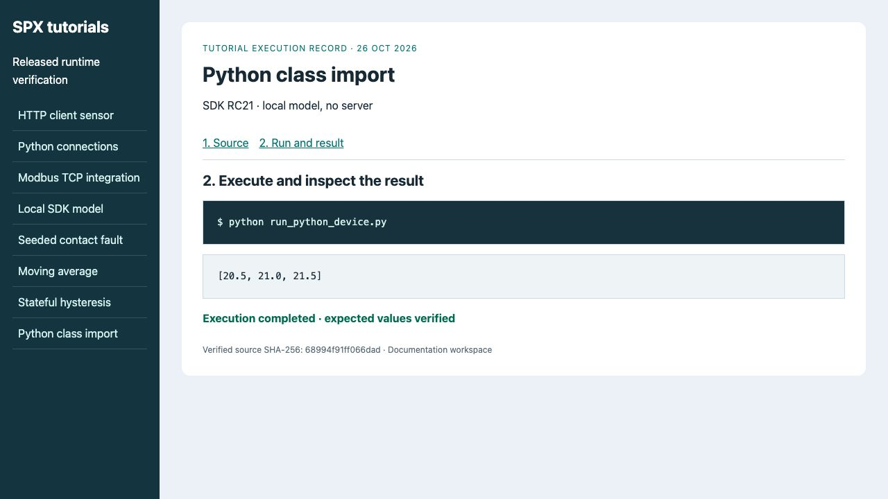

# Load a Python class

**Goal:** a mapped Python property reads **20.5, 21.0, 21.5°C** after three runs.
**Before you start:** the [local SDK environment](../spx-development-guide/quick-start-spx-sdk-in-5-minutes.md).
Use a new directory for the two files below. No server or product key is needed.

## 1. Define the device class

Save as **python_device.py**. Use a real property with getter and setter, because
the importer links SPX's Internal attribute to that property. Each tick adds
0.5°C; the example does not use wall-clock time.
<figure><figcaption><p>The runner resolves the Python file relative to itself, rather than assuming a container-specific path.</p></figcaption></figure>
<!-- tutorial:python_device.py:start -->
```python
"""Plain Python class loaded by the SDK PythonFile importer."""
class TemperatureDevice:
    def __init__(self, start=20.0, increment=0.5):
        self._temperature_c = start
        self.increment = increment

    @property
    def temperature_c(self):
        return self._temperature_c

    @temperature_c.setter
    def temperature_c(self, value):
        self._temperature_c = float(value)

    def tick(self):
        self.temperature_c += self.increment
```
<!-- tutorial:python_device.py:end -->

## 2. Declare the import and run it

Save as **run_python_device.py** beside the first file.
<!-- tutorial:run_python_device.py:start -->
```python
"""Run beside python_device.py: python run_python_device.py."""
from pathlib import Path
from spx_sdk.model import Model


def simulate():
    device_path = str(Path(__file__).with_name('python_device.py').resolve())
    model = Model(name='python_sensor', definition={
        'attributes': {'temperature_c': 20.0},
        'import': {device_path: {
            'class': 'TemperatureDevice',
            'init': {'kwargs': {'start': 20.0, 'increment': 0.5}},
            'attributes': {'temperature_c': {'property': 'temperature_c'}},
            'methods': {'run': 'tick'},
        }},
    })
    try:
        model.prepare()
        result = []
        for tick in range(3):
            model['timer']['time'] = tick / 10
            model.run()
            result.append(model['attributes']['temperature_c'].internal_value)
        assert result == [20.5, 21.0, 21.5], result
        return result
    finally:
        model.destroy()


if __name__ == '__main__':
    print(simulate())
```
<!-- tutorial:run_python_device.py:end -->

The `import` mapping selects the class, constructor arguments, linked property
and `run: tick` lifecycle mapping. `prepare()` loads and links the class.
The SDK uses `model['timer']['time']`; the HTTP client uses
`instance['timer'].time`.

```bash
python run_python_device.py
```

```text
[20.5, 21.0, 21.5]
```

<figure><figcaption><p>The embedded assertion confirms lifecycle calls reached the Python object and its property was readable through SPX.</p></figcaption></figure>

## 3. Move to a server when needed

The import path must exist **inside the server's filesystem**. Mount or install
the two files through your deployment's extension mechanism, use its actual
container path in the model, recreate the instance and verify the same results
through the [HTTP client](../simulation-and-modeling/using-spx-python.md).
Local success does not verify a server mount or a protocol adapter. Only load
Python code you intend to execute. See [PythonFile reference](../spx-development-guide/spx-sdk/imports/pythonfile.md).

The runner destroys its local model. Remove the two files when the exercise is
finished, or keep them as a template for your own device.
