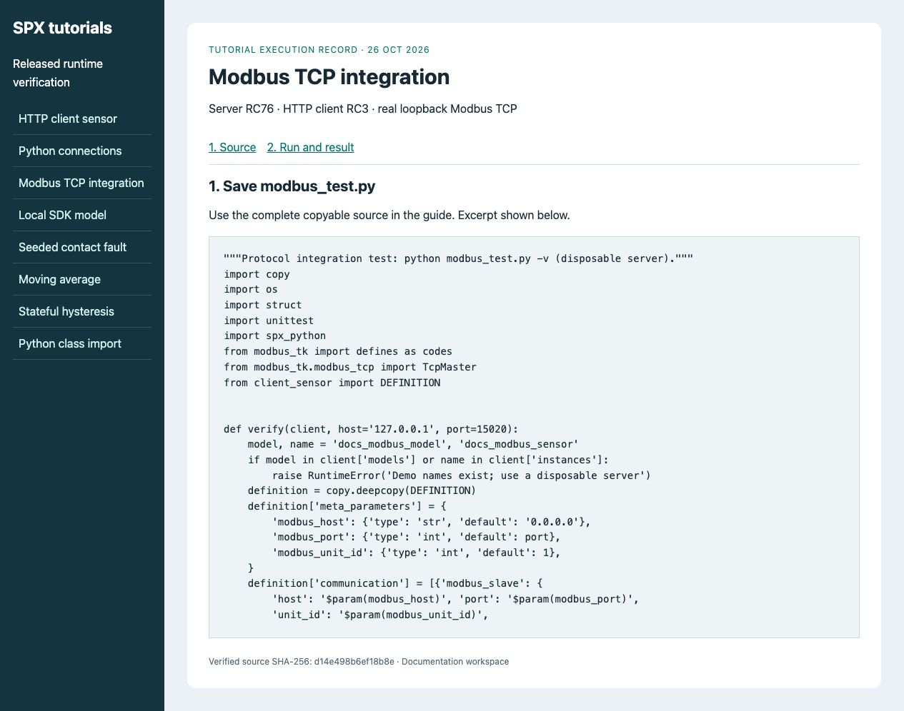
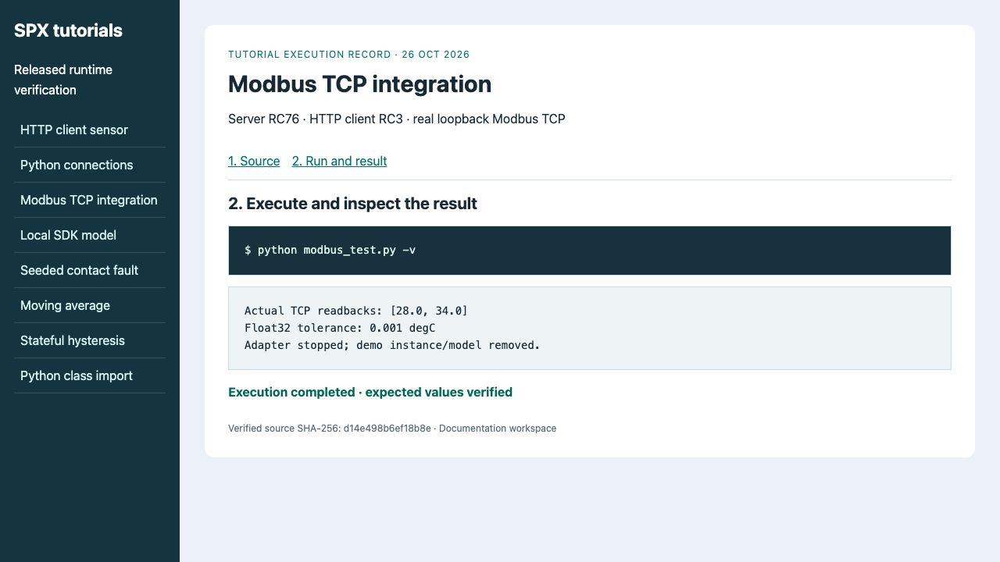

# Test a client over Modbus

**Goal:** a real Modbus TCP client reads **28°C** and **34°C** from SPX holding
registers 0–1 (float32, high word first).
**Before you start:** [First Python program](../simulation-and-modeling/using-spx-python.md),
SPX Server RC76 with the Modbus adapter available, Python 3.12 and a disposable
server. This is a protocol integration test. The API sets up and drives the
simulation; the TCP client performs the read being tested.

## 1. Prepare the network and files

Save `client_sensor.py` from the first Python guide and the program below as
**modbus_test.py** in the same directory. Install the test dependency:

```bash
python -m pip install spx-python==1.0.0rc3 modbus-tk==1.1.5
```

Set `SPX_PRODUCT_KEY` and `SPX_BASE_URL`. The example uses TCP **15020** for
Modbus. With Docker expose that port on the server container (`15020:15020`)
in your project-owned deployment. For a remote server set `SPX_MODBUS_HOST` to
its reachable hostname. Keep host and container ports aligned for this example.
Ensure the port is free; change `SPX_MODBUS_PORT` and the published port together
if necessary. The model binds `0.0.0.0` inside its server environment.

## 2. Run the integration test

<figure><figcaption><p>The protocol client reads two registers after each manual model cycle.</p></figcaption></figure>
<!-- tutorial:modbus_test.py:start -->
```python
"""Protocol integration test: python modbus_test.py -v (disposable server)."""
import copy
import os
import struct
import unittest
import spx_python
from modbus_tk import defines as codes
from modbus_tk.modbus_tcp import TcpMaster
from client_sensor import DEFINITION


def verify(client, host='127.0.0.1', port=15020):
    model, name = 'docs_modbus_model', 'docs_modbus_sensor'
    if model in client['models'] or name in client['instances']:
        raise RuntimeError('Demo names exist; use a disposable server')
    definition = copy.deepcopy(DEFINITION)
    definition['meta_parameters'] = {
        'modbus_host': {'type': 'str', 'default': '0.0.0.0'},
        'modbus_port': {'type': 'int', 'default': port},
        'modbus_unit_id': {'type': 'int', 'default': 1},
    }
    definition['communication'] = [{'modbus_slave': {
        'host': '$param(modbus_host)', 'port': '$param(modbus_port)',
        'unit_id': '$param(modbus_unit_id)',
        'mapping': {'temperature_c': {'address': [0, 1], 'group': 'h_r', 'type': 'float'}},
    }}]
    client['models'][model] = definition
    master = TcpMaster(host=host, port=port, timeout_in_sec=3.0)
    adapter = None
    try:
        client['instances'][name] = model
        instance = client['instances'][name]
        instance.real_time = False
        instance.prepare()
        adapter = instance['communication']['modbus_slave']
        adapter.start()
        result = []
        for tick, expected in enumerate((28.0, 34.0)):
            instance['timer'].time = tick / 10
            instance['attributes']['k__temperature_c'].internal_value = expected
            instance.run(time_step=0.1)
            words = master.execute(1, codes.READ_HOLDING_REGISTERS, 0, 2)
            actual = struct.unpack('>f', struct.pack('>HH', *words))[0]
            assert abs(actual - expected) < 0.001, (words, actual, expected)
            result.append(actual)
        return result
    finally:
        master.close()
        if name in client['instances']:
            if adapter is not None:
                adapter.stop()
            client['instances'][name].stop()
            del client['instances'][name]
        del client['models'][model]


class ModbusIntegration(unittest.TestCase):
    def test_temperature_readback(self):
        client = spx_python.init(address=os.environ.get('SPX_BASE_URL', 'http://localhost:8000'),
                                 product_key=os.environ['SPX_PRODUCT_KEY'])
        self.assertEqual(verify(client, host=os.environ.get('SPX_MODBUS_HOST', '127.0.0.1'),
                                port=int(os.environ.get('SPX_MODBUS_PORT', '15020'))), [28.0, 34.0])


if __name__ == '__main__':
    unittest.main()
```
<!-- tutorial:modbus_test.py:end -->

```bash
python modbus_test.py -v
```

**Expected:** `test_temperature_readback ... ok` and final `OK`.
The client decodes **28.0**, then **34.0**. Each read is checked within 0.001°C.
<figure><figcaption><p>Verified against the released runtime with a real loopback TCP adapter. Docker routing is an additional deployment check.</p></figcaption></figure>

## 3. Interpret and finish

The input API call is the control channel. `TcpMaster.execute` is the protocol
channel. This model has no noise and uses a manual clock; a real external SUT may
still run asynchronously. The test stops the adapter, removes its instance and
then removes its model, including after failed assertions.

Connection refused: check the adapter, published port and client hostname.
Wrong value: inspect word order, register addresses and whether the model cycle
ran after the input write. A healthy HTTP endpoint alone does not verify Modbus.

Continue with [Run tests in CI](ci-cd-setup-github-actions.md) and
[MiL concepts](../simulation-and-modeling/model-in-the-loop.md).
