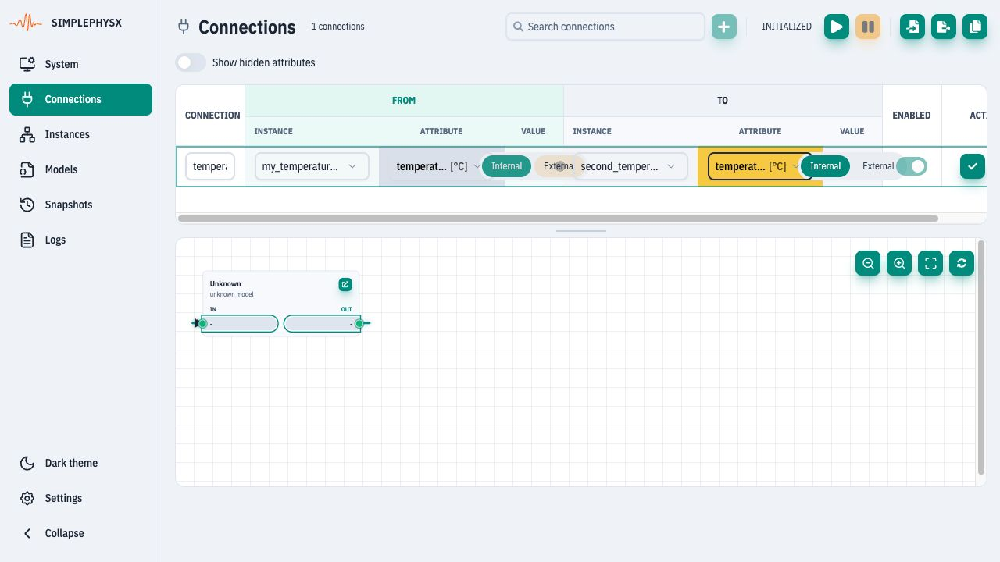
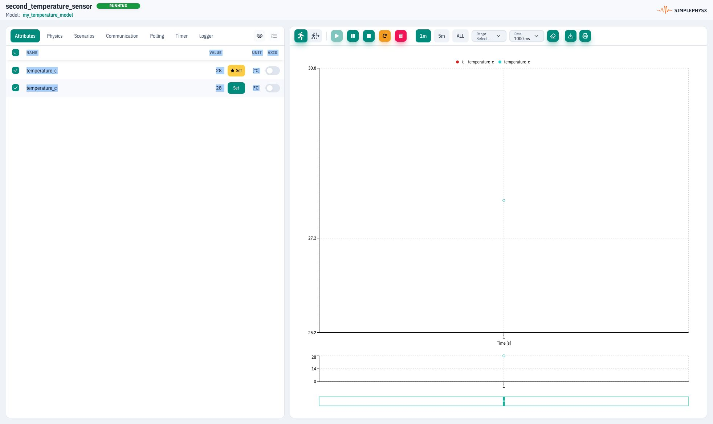

# Connect two instances

**Goal:** changing one sensor makes a second sensor read **28°C**.
**Before you start:** complete [Create and control an instance](ui-instance.md).
Keep `my_temperature_sensor` running. This exercise needs one model and two instances.

## 1. Create the second device

In **Instances → New instance**, use `my_temperature_model` again and name the
new instance **second_temperature_sensor**. Create it, then click its **Start
instance** control. Both sensor instances must be RUNNING.

## 2. Configure the signal path

Open **Connections → Add connection**. Fill the row as follows:

| Field | Exact selection |
| --- | --- |
| Connection name | `temperature_link` |
| From instance | `my_temperature_sensor` |
| From attribute / value | `temperature_c` / **External** |
| To instance | `second_temperature_sensor` |
| To attribute / value | `k__temperature_c` / **Internal** |

The attribute dropdown may shorten both names to “temperature [°C]”. Choose the
ordinary telemetry as From and the yellow key input as To; use the full-name
hover hint to distinguish them. Scroll horizontally to reach the remaining fields.
<figure><figcaption>
Read External telemetry from the first sensor and write the second sensor’s Internal key input.
</figcaption></figure>

Choose **Save connection changes**. Keep **Enabled** on, then use **Start
connections** in the page toolbar if the container is INITIALIZED.

## 3. Check the graph and runtime state

Choose **Fit graph to view**. Find the arrow from `my_temperature_sensor` to
`second_temperature_sensor`.
<figure><figcaption>
RUNNING starts the propagation container; Active confirms that this connection is propagating.
</figcaption></figure>

**Check:** the container is RUNNING and the row says **Active**. Enabled alone
is not sufficient. Direction comes from From → To, not from the slot names.

## 4. Prove propagation

Return to the first sensor's Instance View. Under **Attributes**, Set the
Internal `k__temperature_c` to **28** and apply. Open the second sensor's details
from Instances and inspect its Attributes.
<figure><figcaption>
Both values on the second sensor become 28°C after the connection and model cycles.
</figcaption></figure>

**Completion check:** first telemetry = 28; second input = 28; second telemetry
= 28. Allow model execution, propagation and browser refresh to complete.

## Finish or continue

Disable or delete only `temperature_link` when done; stop the second sensor if
you no longer need it. Continue with the
[five-instance energy example](ui-building-energy.md), whose import replaces
this configuration, or use [Python connections](python-connections.md) on a
separate disposable server. For all controls see [Connections reference](../ui-reference/connections.md).
