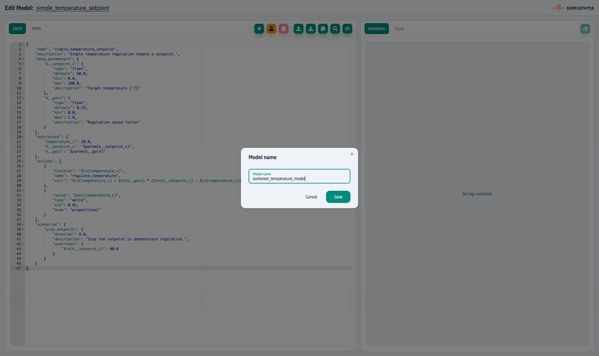
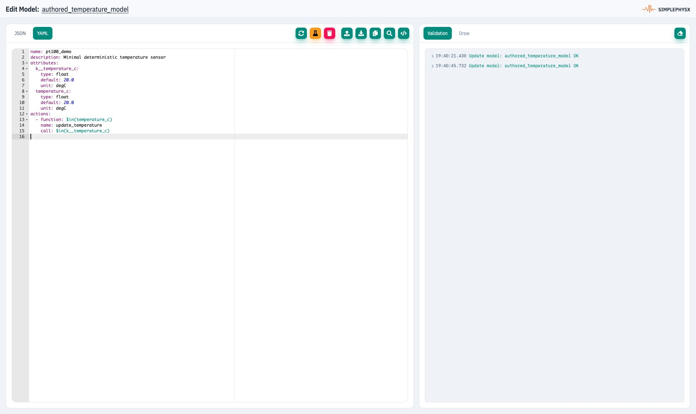
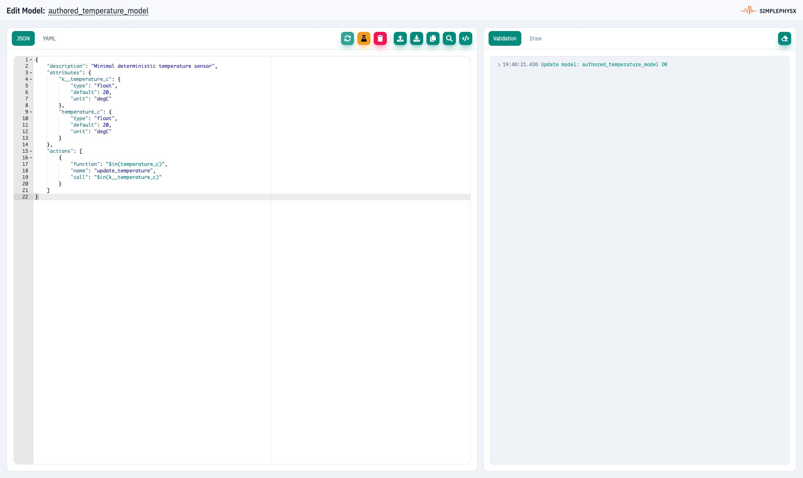
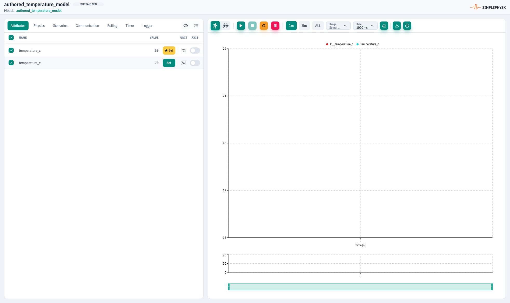
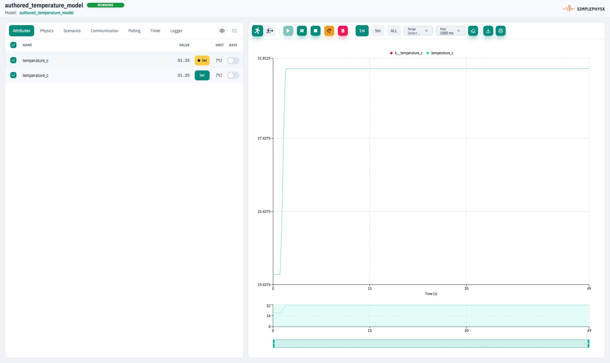

# Create a YAML or JSON model

**Goal:** save `authored_temperature_model`, test it in the UI and verify a
**31.25°C** readback. **Before you start:** [UI setup](ui.md#before-the-exercises),
capacity for one model and instance, and a disposable workspace. This exercise
shows model authoring; [operating a ready-made model](ui-instance.md) is the shorter
path when you only want to run a simulation.

## 1. Open the editor and name the model

In **Models**, choose **New model**. A Model View opens in a separate tab.
Click **Edit model name** in its header, enter **authored_temperature_model**,
and choose **Save** in the name dialog. This sets the registry name; it does
not yet save the model definition to the server.
<figure><figcaption><p>Give the model a registry name distinct from the other exercises.</p></figcaption></figure>

## 2. Replace the starter definition

Choose **YAML**. Select all of the starter code in the editor and replace it
with this complete definition:

<!-- model:pt100:start -->
```yaml
name: pt100_demo
description: Minimal deterministic temperature sensor
attributes:
  k__temperature_c:
    type: float
    default: 20.0
    unit: degC
  temperature_c:
    type: float
    default: 20.0
    unit: degC
actions:
  - function: $in(temperature_c)
    name: update_temperature
    call: $in(k__temperature_c)
```
<!-- model:pt100:end -->

<figure><figcaption><p>Replace the entire starter definition. Appending a second definition produces duplicate YAML keys.</p></figcaption></figure>

`k__temperature_c` is the input; `temperature_c` is the processed telemetry.
Both use `degC`. The named function action copies the input to telemetry each
cycle. The definition's `name` is metadata; the registry name is the key used
when creating an instance. No communication endpoint is needed for this example.

## 3. Save and inspect JSON

Click **Create model** (or **Update model** for an existing model). Check the
**Validation** panel for an **OK** entry for `authored_temperature_model`.
Choose **JSON** to inspect the equivalent representation. A server-normalized
view can omit metadata such as the definition's `name`; check the attributes
and actions rather than requiring byte-for-byte formatting.
<figure><figcaption><p>JSON and YAML express the same model behavior. An OK save is followed by an execution test.</p></figcaption></figure>

The [model language reference](../simulation-and-modeling/model-definition-reference.md)
contains complete equivalent YAML/JSON definitions and deployment meta-parameter
rules. New communication models should parameterize hostnames, ports and device IDs.

## 4. Create and run a test instance

Click **Test model**. For this model there are no required meta parameters;
the test Instance View opens in another tab. In this UI version its default
instance name is **authored_temperature_model**, the same as the model registry
key. Check both the instance header and its model before changing anything.
<figure><figcaption><p>Creating a test instance does not automatically start the simulation.</p></figcaption></figure>

Choose **Start instance** in Continuous mode. Under Attributes, Set the Internal
`k__temperature_c` to **31.25**, apply, then wait for telemetry to follow.
<figure><figcaption><p>Completion: the saved definition executes and telemetry follows the input.</p></figcaption></figure>

Stop and delete this exercise's test instance before deleting its model.
If validation fails, check complete replacement, YAML indentation and registry
name. If runtime fails, inspect Physics and Logger in the instance view.
For public Examples contributions follow [repository rules](../llm-first-model-authoring/repo-as-spec.md).
Next run a [local SDK model](../spx-development-guide/quick-start-spx-sdk-in-5-minutes.md).
