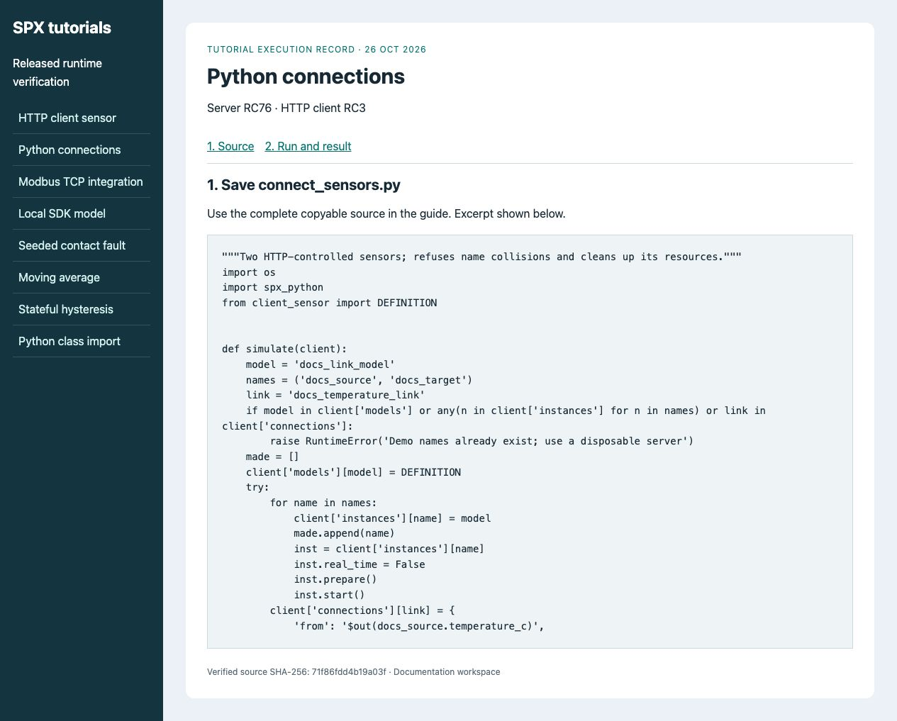
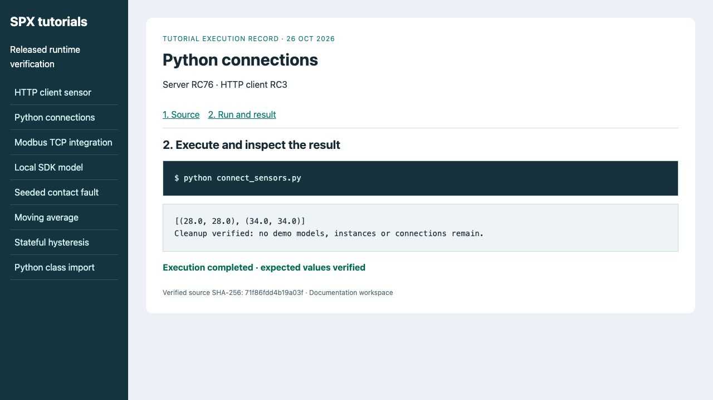

# Connect instances with Python

**Goal:** target telemetry reads **28°C**, then **34°C**.
**Before you start:** complete [First Python program](../simulation-and-modeling/using-spx-python.md),
with capacity for one model and two instances on a disposable server.
Save `client_sensor.py` from that guide beside the script below; it supplies
`DEFINITION`. The demo refuses to replace any of its reserved names.

## 1. Save the program

Save as **connect_sensors.py**. Source → connection → target is the explicit
execution order. Starting this individual connection allows manual Run without
starting the global background container.
<figure><figcaption><p>The same source/target distinction is visible in the UI connections exercise.</p></figcaption></figure>
<!-- tutorial:connect_sensors.py:start -->
```python
"""Two HTTP-controlled sensors; refuses name collisions and cleans up its resources."""
import os
import spx_python
from client_sensor import DEFINITION


def simulate(client):
    model = 'docs_link_model'
    names = ('docs_source', 'docs_target')
    link = 'docs_temperature_link'
    if model in client['models'] or any(n in client['instances'] for n in names) or link in client['connections']:
        raise RuntimeError('Demo names already exist; use a disposable server')
    made = []
    client['models'][model] = DEFINITION
    try:
        for name in names:
            client['instances'][name] = model
            made.append(name)
            inst = client['instances'][name]
            inst.real_time = False
            inst.prepare()
            inst.start()
        client['connections'][link] = {
            'from': '$out(docs_source.temperature_c)',
            'to': '$in(docs_target.k__temperature_c)',
        }
        connection = client['connections'][link]
        # Explicit manual propagation: do not start the global background container.
        connection.start()
        result = []
        source, target = (client['instances'][n] for n in names)
        for tick, expected in enumerate((28.0, 34.0)):
            source['attributes']['k__temperature_c'].internal_value = expected
            for inst in (source, target):
                inst['timer'].time = tick / 10
            source.run(time_step=0.1)
            connection.run()
            target.run(time_step=0.1)
            actual = target['attributes']['temperature_c'].external_value
            assert actual == expected, (actual, expected)
            result.append((expected, actual))
        return result
    finally:
        if link in client['connections']:
            client['connections'][link].stop()
            del client['connections'][link]
        for name in made:
            client['instances'][name].stop()
            del client['instances'][name]
        del client['models'][model]


if __name__ == '__main__':
    client = spx_python.init(address=os.environ.get('SPX_BASE_URL', 'http://localhost:8000'),
                             product_key=os.environ['SPX_PRODUCT_KEY'])
    print(simulate(client))
```
<!-- tutorial:connect_sensors.py:end -->

## 2. Run and verify

```bash
python connect_sensors.py
```

```text
[(28.0, 28.0), (34.0, 34.0)]
```

Each tuple is `(requested_input, target_telemetry)`.
<figure><figcaption><p>Both changes propagate; a saved connection definition alone would not prove this.</p></figcaption></figure>

**Completion:** both pairs match. The script stops/deletes its link before its
two instances and model. If a failure reports name collisions, inspect ownership
or use a fresh workspace instead of deleting unknown resources.

For continuous live wiring see [Connect two instances in the UI](connect-instances.md)
and [MCP lifecycle rules](../getting-started/mcp-reference.md).
