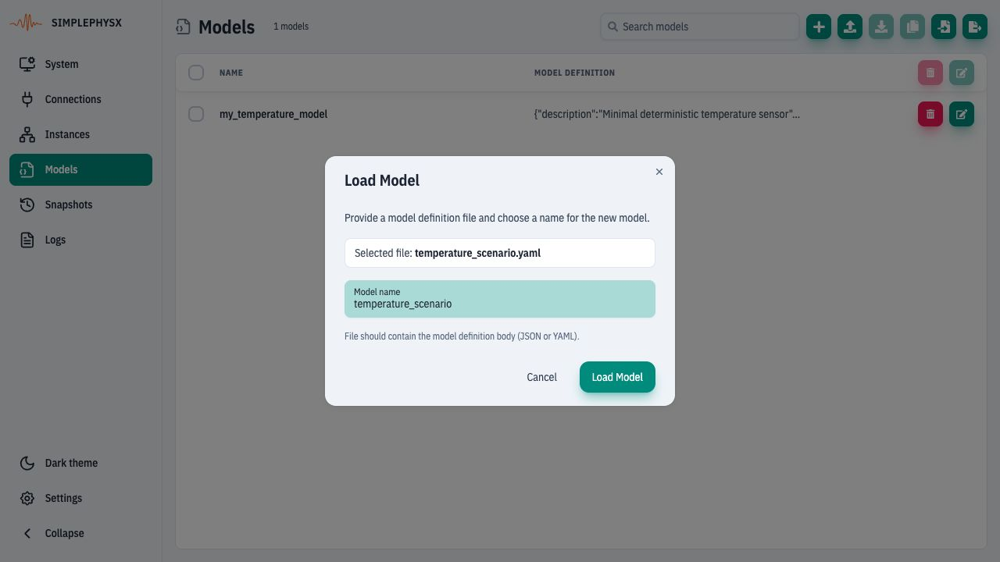
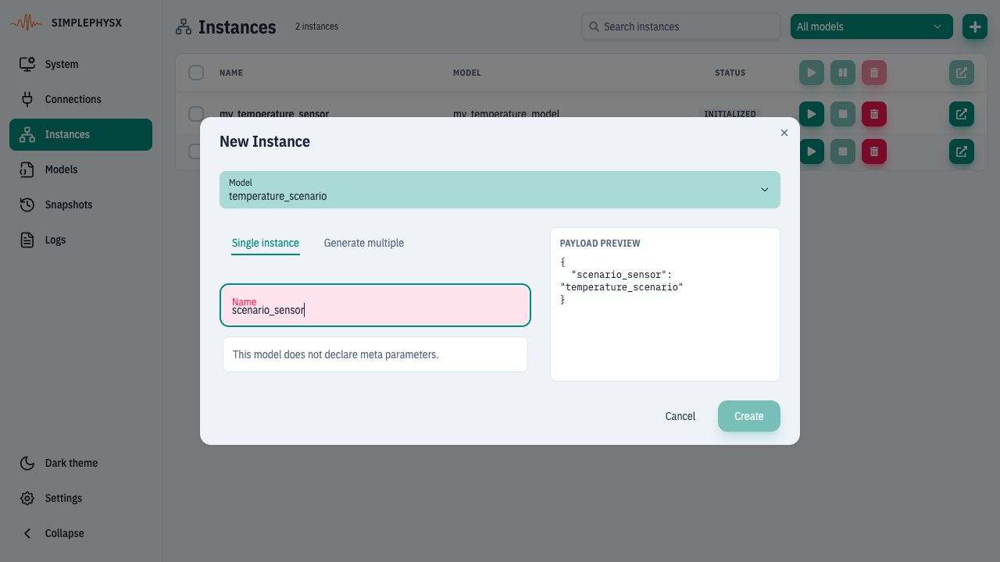
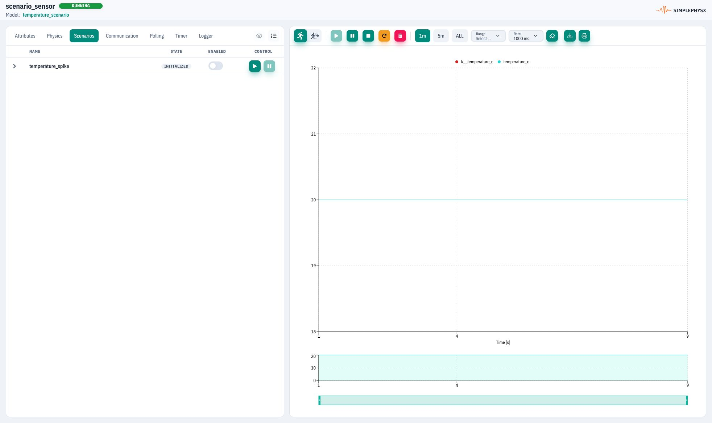
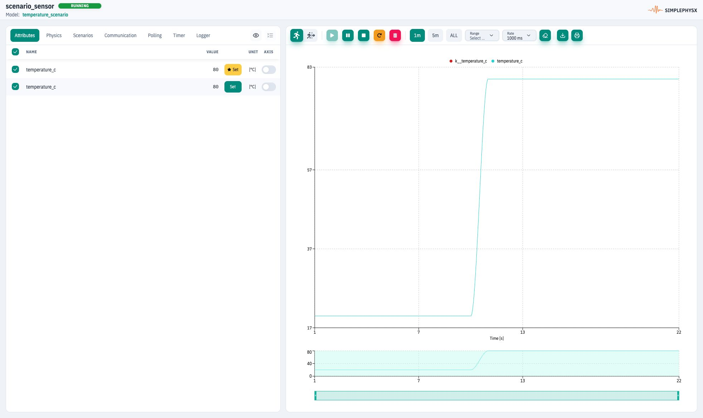

# Run a scenario

**Goal:** observe **20 → 80 → 20°C** by starting and stopping one named scenario.
**Before you start:** [UI setup](ui.md#before-the-exercises), with space for one
additional model and instance. This is an independent exercise; the ordinary
introductory sensor does not define scenarios.

## 1. Load the scenario model

Download [temperature_scenario.yaml](https://raw.githubusercontent.com/HammerHeads-Engineers/spx-docs/main/examples/guides/temperature_scenario.yaml).
In **Models → Load model from file**, select it and keep the registry name
**temperature_scenario**.
<figure><figcaption>
This model adds an opt-in temperature_spike scenario to the same simple sensor behavior.
</figcaption></figure>

In **Instances → New instance**, select that model, name the instance
**scenario_sensor**, create it and start it in Continuous mode.
<figure><figcaption>
Create a separate instance so the exercise does not alter another running sensor.
</figcaption></figure>

## 2. Record the baseline

Open the instance details and **Attributes**. Confirm RUNNING and **20°C** in
`k__temperature_c` and `temperature_c`.
<figure><figcaption>
Baseline: input and telemetry are both 20°C before starting the scenario.
</figcaption></figure>

## 3. Start the disturbance

Open **Scenarios** (under **More tabs** on a narrow panel). Locate
**temperature_spike** and click **Start temperature_spike scenario**.
The initial Enabled switch is off because this scenario does not auto-start
with its parent. Manual Start activates it.
<figure><figcaption>
Start the named scenario explicitly; do not start an unrelated scenario.
</figcaption></figure>

**Check:** its state becomes RUNNING. Return to **Attributes** and wait for the
next cycle: both input and telemetry become **80°C**.
<figure><figcaption>
The override holds the input at 80°C until you stop the scenario.
</figcaption></figure>

## 4. Stop and verify restoration

Return to **Scenarios**, click **Stop temperature_spike scenario**, then inspect
Attributes again. Wait for the next model cycle and UI refresh.
<figure><figcaption>
Completion: the override restores the previous input and telemetry returns to 20°C.
</figcaption></figure>

This model uses an `overrides` block with `duration: -1`, so the disturbance
stays active until stopped. Other models may use timed scenarios or ordinary
actions whose writes remain after stop. Check the definition instead of assuming
all scenarios restore values. See [Scenario reference](../spx-core/system/scenarios.md).

Stop `scenario_sensor` after the exercise. Remove only its instance/model if no
longer needed. Continue with [Save and restore](ui-save-restore.md).
