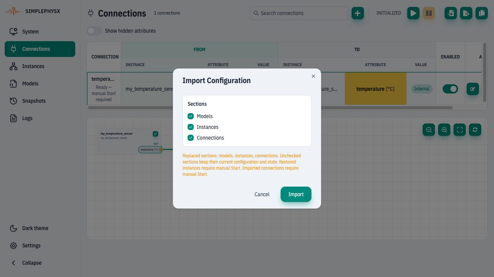
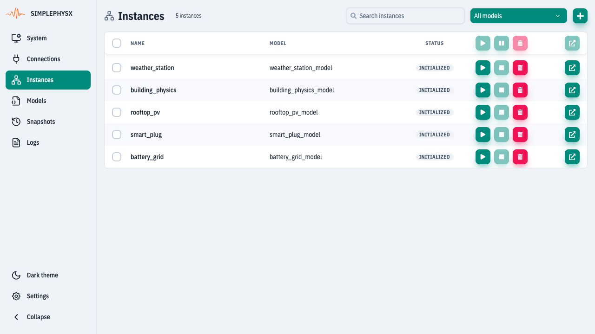
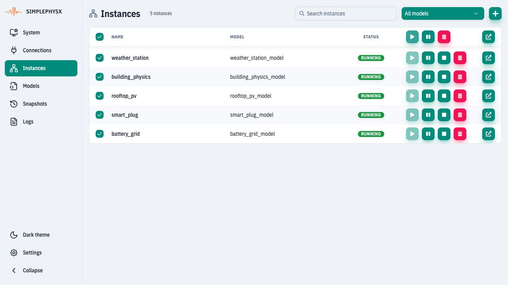
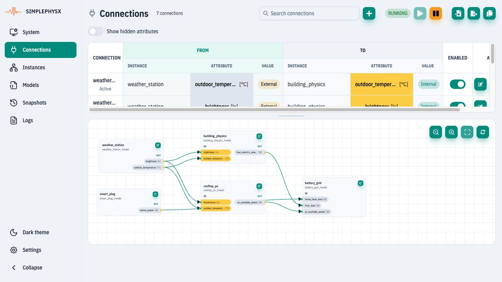

# Build a building-energy simulation

**Goal:** five RUNNING instances, seven active connections and a visible path
from weather through building/PV to battery/grid.
**Before you start:** [UI setup](ui.md#before-the-exercises), capacity for five
models and five instances, and a disposable workspace. The teaching models
contain no active protocol adapters and need no broker or physical device.

## 1. Import the supplied configuration

[Download the example bundle](https://raw.githubusercontent.com/HammerHeads-Engineers/spx-docs/7c2db092df1b9a3257be5e32708f4967bf564984/.gitbook/assets/building-energy-five-instances.zip)
and extract its JSON file. Export anything you need from the current workspace
first. Open **Connections → Import configuration**, select the JSON and review
**Models**, **Instances** and **Connections**.
<figure><figcaption><p>These three sections will be replaced. Import into the disposable workspace prepared for this exercise.</p></figcaption></figure>

Choose **Import**. The bundle supplies configuration and defaults; graph layout,
collected chart history and a running state are not included.

## 2. Start the five instances

Open **Instances**, clear any model/search filter and check these exact names:

| Instance | Role |
| --- | --- |
| `weather_station` | Outdoor temperature and daylight source. |
| `building_physics` | Simplified building thermal behavior and HVAC electricity. |
| `rooftop_pv` | Available PV power from weather inputs. |
| `smart_plug` | Switched 1,500 W household load. |
| `battery_grid` | Load, generation, battery and grid electrical balance. |

Select only these five rows and click **Start selected instances**.
<figure><figcaption><p>Check the names before applying a bulk action.</p></figcaption></figure>

**Check:** each row says RUNNING.
<figure><figcaption><p>Five running devices are necessary before testing the full signal path.</p></figcaption></figure>

## 3. Start propagation and inspect the graph

Open **Connections** and click **Start connections**. Confirm seven rows become
**Active**. Click **Fit graph to view**; drag the table/graph divider if needed.
<figure><figcaption><p>Weather drives the building and PV; HVAC, PV and plug power feed battery_grid.</p></figcaption></figure>

The [endpoint table](../ui-reference/connections.md#graph-example-building-energy-balance)
lists every source and target. Sources are External telemetry; targets are
Internal inputs. Hover over shortened attribute labels to inspect full names.
Selecting a connection highlights its path.

## 4. Read the electrical balance

Open `battery_grid` from Instances. In Attributes inspect `pv_power_w`,
`battery_power_w`, `grid_power_w` and `load_power_w`:

```text
pv_power_w + battery_power_w + grid_power_w = load_power_w
```

All four quantities are watts. Battery positive = discharge, negative = charge;
grid positive = import, negative = export. The load is plug + HVAC electricity;
EV load is zero. The thermal behavior is calculated inside the building model.
UI reads may sample different cycles, so do not demand exact equality from four
separately refreshed cells. Use controlled Python steps for strict assertions.

These are simplified teaching models, not a calibrated building assessment.
Continue with [Observe signals and test behavior](ui-observe.md) to see the
response to a daylight change. When finished, stop the connections and these
five instances; keep or export the configuration for the next exercise.
