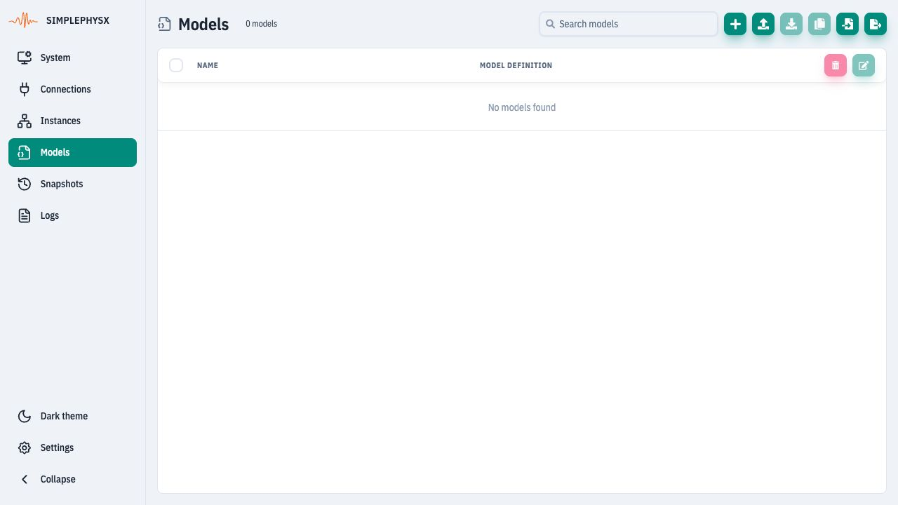
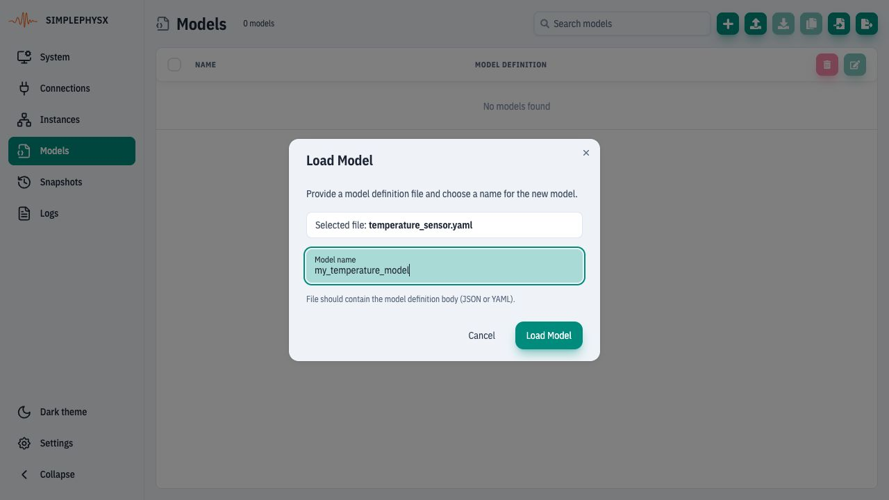
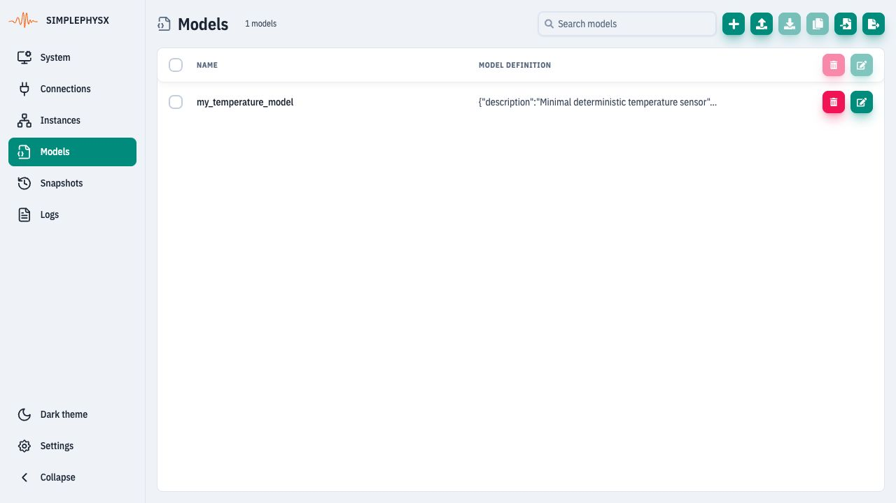
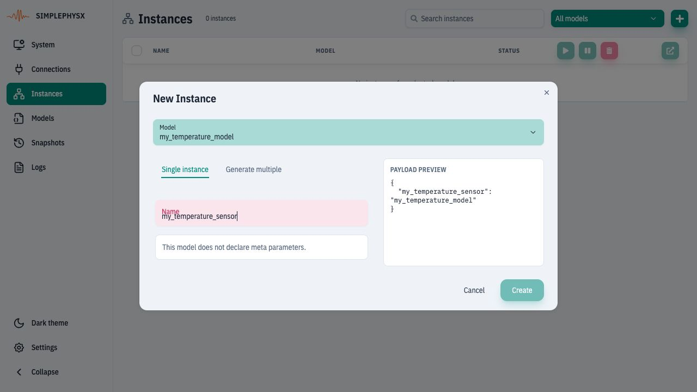
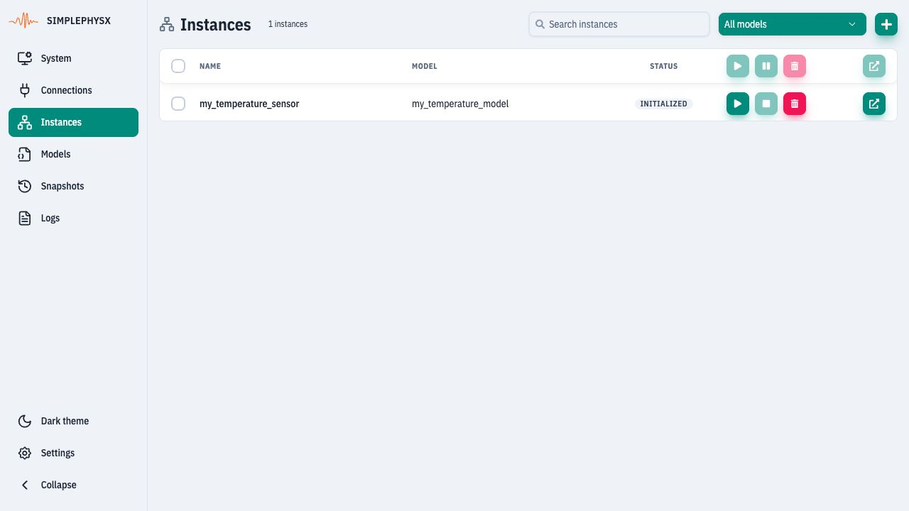
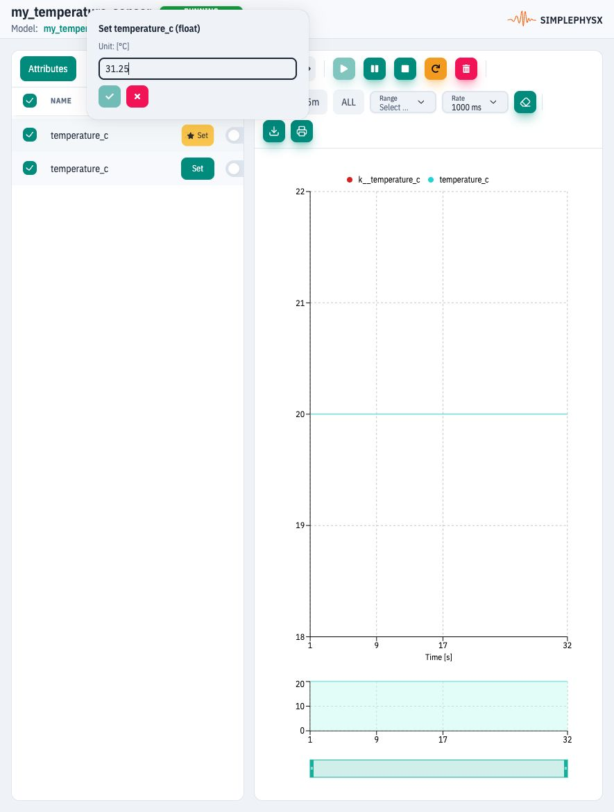

# Create and control an instance

**Goal:** run `my_temperature_sensor` and make its telemetry read **31.25°C**.
**Before you start:** complete [UI setup](ui.md#before-the-exercises), with space
for one model and one instance. Reserve the names below; use a fresh workspace
if either already belongs to another exercise.

## 1. Load the ready-made model

Open **Models** in the sidebar and choose **Load model from file**. Save
[this model file](https://raw.githubusercontent.com/HammerHeads-Engineers/spx-docs/main/examples/guides/temperature_sensor.yaml)
to your computer, then select it in the file picker. It is a model definition,
not a full system configuration.
<figure><figcaption>
Models is selected in the sidebar. Load model from file imports one definition.
</figcaption></figure>

In **Load Model**, enter **my_temperature_model** as Model name and click
**Load Model**. The registry name identifies the saved model; the definition's
`name: pt100_demo` is metadata.
<figure><figcaption>
Choose the supplied YAML file and save it as my_temperature_model.
</figcaption></figure>

**Check:** the Models list contains `my_temperature_model`.
<figure><figcaption>
The saved model is now available when creating an instance.
</figcaption></figure>

## 2. Create an instance

Open **Instances**, click **New instance**, select model `my_temperature_model`,
and keep **Single instance** selected. Enter **my_temperature_sensor** as Name
and choose **Create**. No meta parameters are needed for this protocol-free model.
<figure><figcaption>
The model is the reusable definition; the instance is the device you will run.
</figcaption></figure>

**Check:** the row exists. Its initial state is **INITIALIZED**, which means it
has been created but has not started.
<figure><figcaption>
Use Start instance on this row to begin continuous execution.
</figcaption></figure>

## 3. Start and open the device

Click the row's **Start instance** button, then **Open instance details**. The
Instance View opens in another tab. Keep **Continuous** mode selected.

**Check:** the header says **RUNNING**. Open **Attributes**; both input
`k__temperature_c` and telemetry `temperature_c` initially read **20°C**.

## 4. Change the input

Use **Set** on the yellow key-input row `k__temperature_c`, enter **31.25**, then
click **Apply value**. The label may omit `k__`; hover over the name to check its
full path. If columns do not fit, drag the panel divider or scroll the table.
<figure><figcaption>
Write the key input. Applying a value does not by itself prove that model execution updated telemetry.
</figcaption></figure>

**Check:** after the next model cycle and UI refresh, **both rows read 31.25**.
The curves overlap because this model copies the input to telemetry without noise.
<figure><figcaption>
The matching telemetry reading confirms that the simulation processed the input.
</figcaption></figure>

## Finish or continue

For [Connect two instances](connect-instances.md), keep this sensor running.
Otherwise choose **Stop instance**. Delete only this exercise's instance and then
its model if you want to remove them; leave unrelated resources intact.

If the value does not follow, confirm RUNNING, the input's full name and the
successful edit. See [Instances reference](../ui-reference/instances.md).
To author the YAML yourself, use [Create a YAML or JSON model](model-authoring.md).
