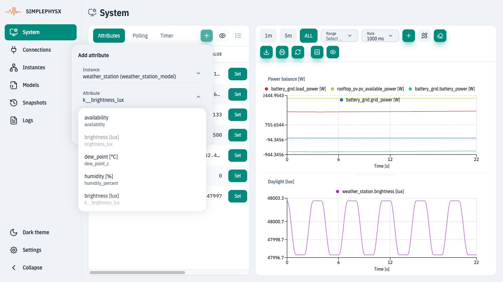
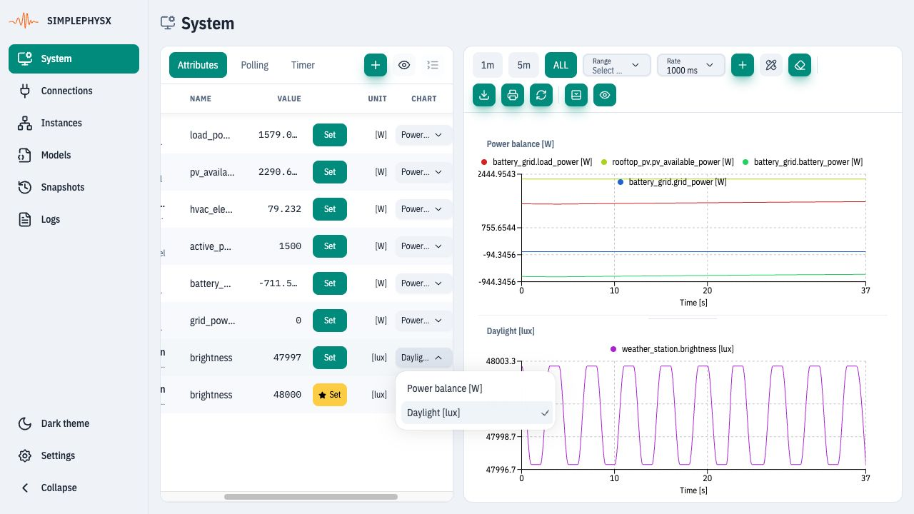
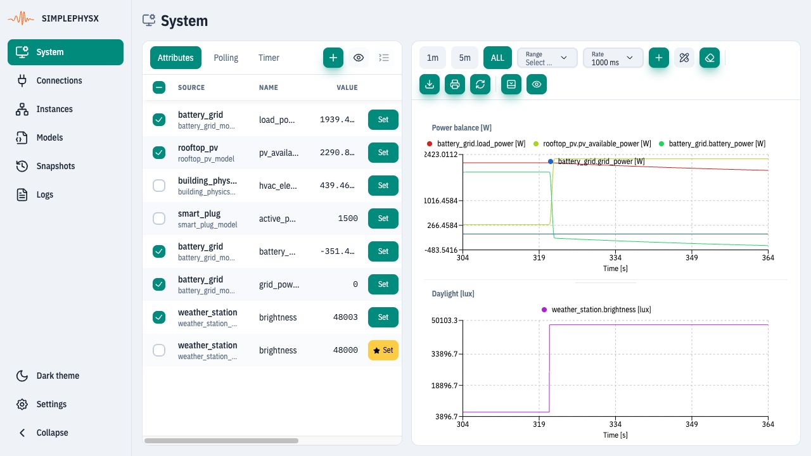
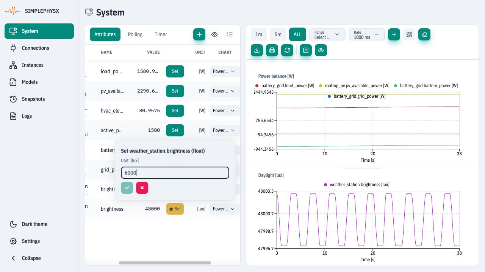
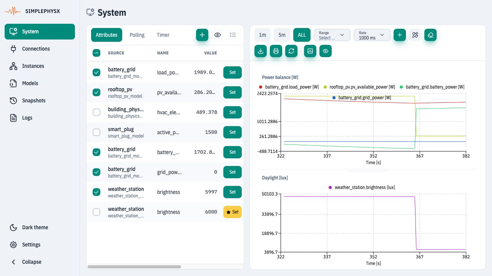

# Observe signals and test behavior

**Goal:** lower daylight from **48,000 to 6,000 lux**, observe falling PV power
and the battery/grid response, and export chart data.
**Before you start:** complete [Building-energy simulation](ui-building-energy.md).
Keep all five instances and the Connections container RUNNING.

## 1. Add the watched attributes

Open **System → Attributes → Add system attribute** (+). Select an instance,
then an attribute, and click **Add**. Repeat for:

| Instance | Attribute | Plot |
| --- | --- | --- |
| `battery_grid` | `load_power_w` | Power balance [W] |
| `rooftop_pv` | `pv_available_power_w` | Power balance [W] |
| `battery_grid` | `battery_power_w` | Power balance [W] |
| `battery_grid` | `grid_power_w` | Power balance [W] |
| `building_physics` | `hvac_electric_power_w` | Table only |
| `smart_plug` | `active_power_w` | Table only |
| `weather_station` | `brightness_lux` | Daylight [lux] |
| `weather_station` | `k__brightness_lux` | Table only; control input |

<figure><figcaption>
Select the instance first, then the exact attribute. The k__ row provides the control for step 3.
</figcaption></figure>

## 2. Separate power and daylight

Click **Chart 1**'s title to rename it **Power balance [W]**. Choose **Add chart**
and name the second chart **Daylight [lux]**. In the `brightness_lux` row's
**Chart** selector choose Daylight. Uncheck the HVAC, plug and `k__brightness_lux`
rows to keep them in the table without plotting them.
<figure><figcaption>
Assign illuminance to its own lux chart; watts and lux need different scales.
</figcaption></figure>

**Check:** four power curves use Power balance and one daylight curve uses
Daylight. Capture at least several seconds of baseline before editing an input.
<figure><figcaption>
Baseline: daylight is about 48,000 lux. Small variations in weather telemetry are expected.
</figcaption></figure>

## 3. Change daylight while keeping the charts open

In the unchecked `weather_station.k__brightness_lux` row click **Set**, enter
**6000**, and choose **Apply value**. If necessary scroll the table horizontally
or drag the panel divider. This writes the input's Internal value.
<figure><figcaption>
Change the key input, rather than overwriting calculated brightness or PV telemetry.
</figcaption></figure>

Allow time for the weather, connection, PV, ESS and UI cycles. Keep System open:
navigating away or reloading discards its collected chart history. An alternative
is to edit the weather instance in a second tab connected to the same server.
<figure><figcaption>
Daylight and available PV power fall; battery/grid power adjusts to the remaining load.
</figcaption></figure>

**Completion check:** `k__brightness_lux` = 6000, measured `brightness_lux` is
near 6000, available PV power is lower than the baseline, and the power traces
show the battery/grid response. Exact values depend on elapsed simulation time
and model state. Restore **48000** to try the reverse change.

## 4. Export the observations

Choose **ALL** for the full collected interval, then **Export CSV**. Save/open
the CSV and check that it contains time and the five plotted signals. Signals
added after acquisition began have no earlier samples.

Chart time is elapsed browser acquisition time, not the model clock. Chart
**Rate** changes browser reads; it does not change runtime Timer or Polling.
Chart settings may persist in this browser, but chart history is not a server
historian or a snapshot checkpoint. See [System reference](../ui-reference/system.md).

If the charts remain flat, inspect instance and connection states before
changing the refresh rate. Stop these demo instances/connections when done,
or continue with [Save and restore](ui-save-restore.md).
