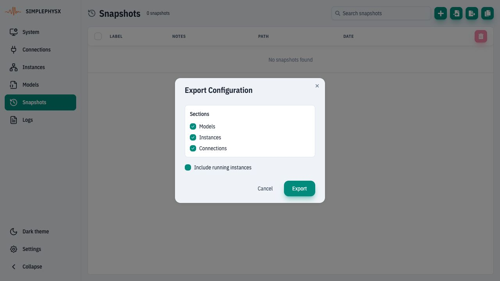
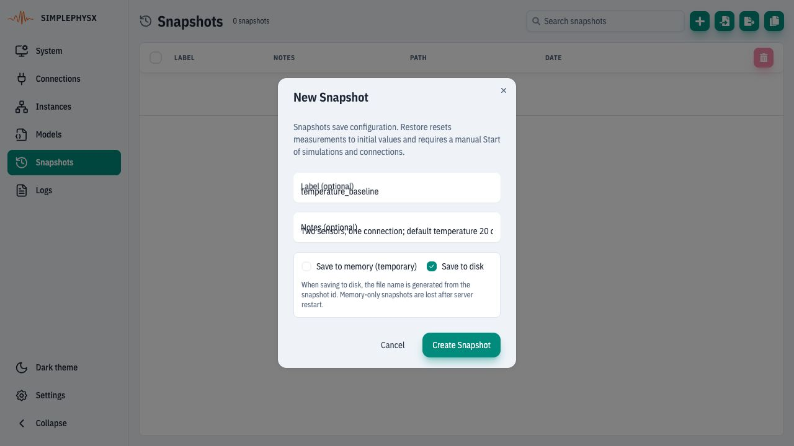
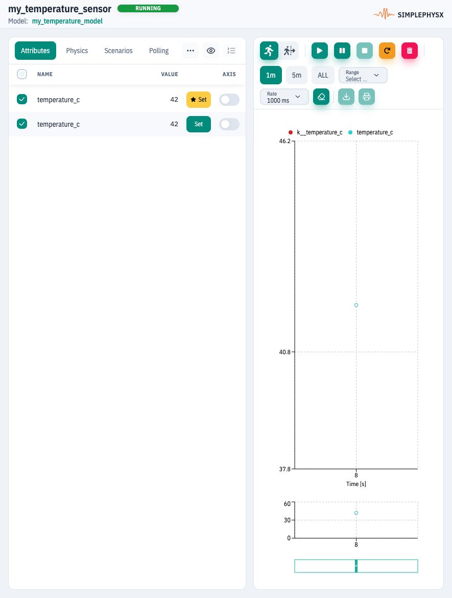
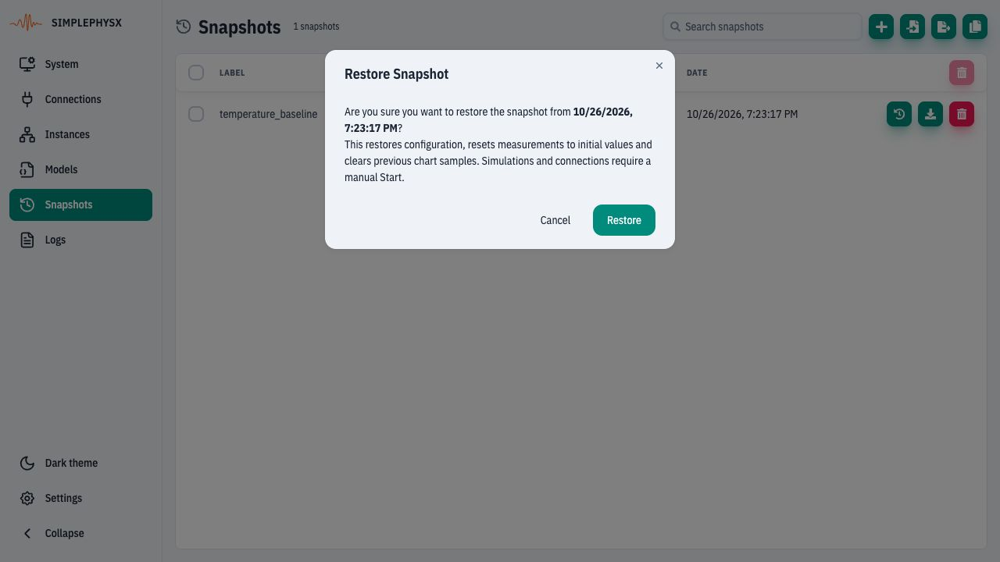
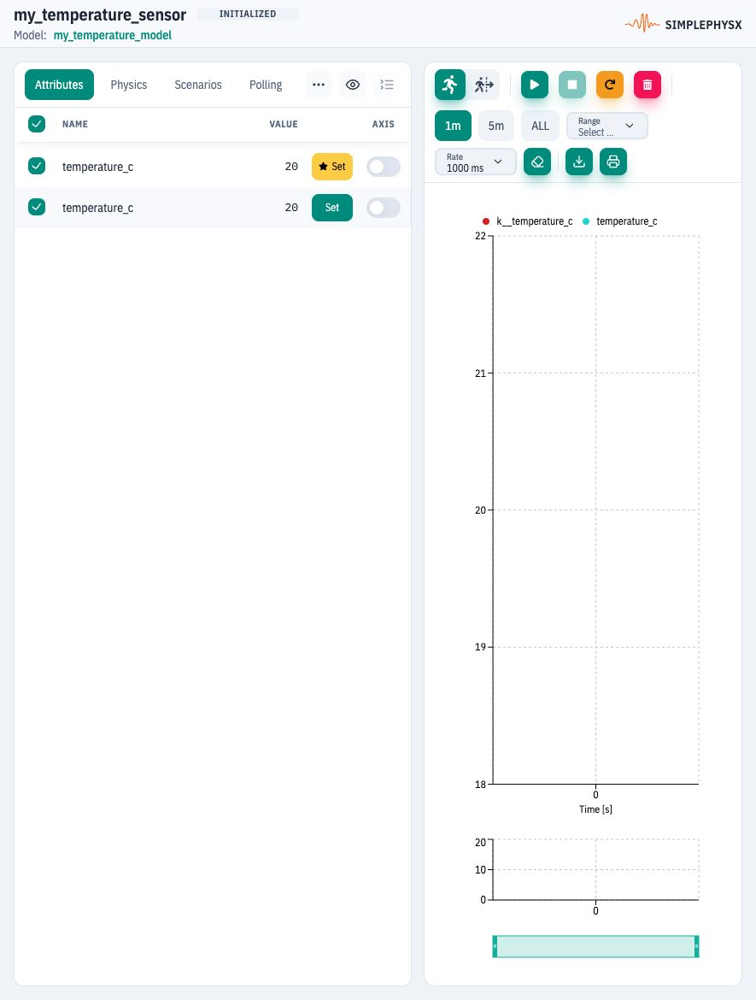

# Save and restore a configuration

**Goal:** save a baseline, change a runtime input, restore the configuration and
verify the reconstructed defaults.
**Before you start:** a disposable workspace with the two sensors from
[Connect two instances](connect-instances.md). Their model default is **20°C**.
The same procedure works for the energy example, using that bundle's own defaults.

## 1. Export a portable configuration

Open **Snapshots → Export configuration**. Keep **Models**, **Instances** and
**Connections** selected. For an explicit manual restart, uncheck **Include
running instances**. Choose **Export**, then complete your browser's file-save
dialog and keep the JSON file.
<figure><figcaption>
Export definitions and wiring; omit automatic instance-start instructions for this exercise.
</figcaption></figure>

To move the setup to another disposable environment, use **Import configuration**,
select the JSON and review the replacement sections. Importing is not merging
a running workspace. Recheck instance/connection states afterwards.

## 2. Save a named baseline

Choose **New snapshot**, enter Label **temperature_baseline**, and add a note
that the model default is 20°C. Keep **Save to disk** selected and click
**Create Snapshot**. Disk paths belong to the server; memory-only snapshots
are temporary and are lost after restart.
<figure><figcaption>
Save the structure before the experiment. The note explains the defaults to expect on restore.
</figcaption></figure>

**Check:** the snapshot appears in the list. In the first sensor's Instance View,
Set `k__temperature_c` to **42**; confirm telemetry becomes 42°C.
<figure><figcaption>
This runtime change is the experiment; it does not change the model’s 20°C default.
</figcaption></figure>

## 3. Restore the baseline

Return to **Snapshots**, find `temperature_baseline`, and click **Restore
snapshot** on that row. Read the confirmation and choose **Restore**, then
acknowledge the success message.
<figure><figcaption>
Restore replaces the saved configuration and resets measurements. Use only the disposable workspace.
</figcaption></figure>

Reload/reopen the sensor details so the UI reacquires the reconstructed instance.
<figure><figcaption>
The restored sensor reads 20°C and is INITIALIZED. It did not resume the earlier 42°C state.
</figcaption></figure>

**Check:** the two sensors and `temperature_link` exist; their model default is
20°C. The saved 28°C/42°C runtime readings and previous chart history do not
resume. A snapshot restores configuration; it is not a runtime checkpoint.

## 4. Restart and prove the restored wiring

In **Instances**, start both sensors. In **Connections**, start the container
and confirm `temperature_link` becomes Active. Set the first sensor's input to
**28** and confirm the second sensor's input and telemetry become **28** again.
Stop these two sensors and the demo connection when finished.

If you use a different model, reapply its experiment inputs and warmup explicitly.
See [Snapshots UI reference](../ui-reference/snapshots.md) and
[Save configuration with Python](../getting-started/snapshots-guide.md).
