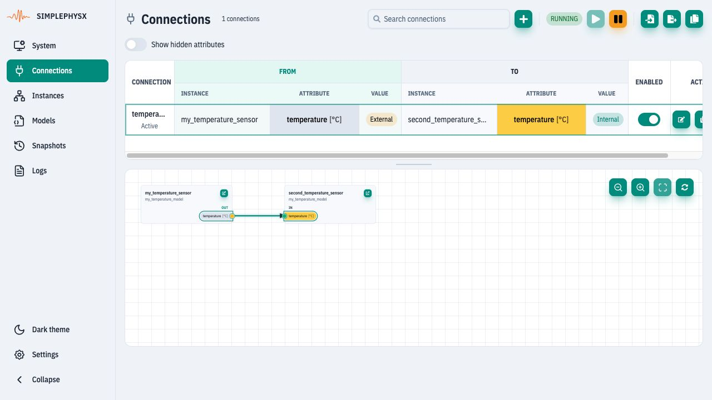

# Core Concepts

<figure><figcaption>
One reusable model has two live instances; the arrow transfers a telemetry value into an input.
</figcaption></figure>

A **model definition** describes attributes, behavior and communication. A
**model registry key** identifies that definition on a server. An **instance**
is a live copy with its own state. A **connection** transfers values between
instances; a protocol adapter connects the simulation to an external SUT.
See the [identifier glossary](../appendices/glossary-of-terms.md#model-identifiers).

## Internal and external values

`$in(name)` selects the internal value wrapper and `$ext(name)` selects the
external wrapper. Both may appear as a source or destination. Direction comes
from the action or binding, not from the prefix. Neither is an access-control rule.

| Operation, starting from internal=20 | Internal afterwards | External afterwards |
| --- | --- | --- |
| Write external=99 | 20 | 99 |
| Then write internal=21 | 21 | 21 |

An internal write **clears** the external override. A noise/fault action can
reapply an external value after each internal update. Protocol bindings choose
which view they expose and whether the protocol permits writes.

Use `k__*` for persistent control inputs, `cmd__*` for command/trigger inputs,
plain names for ordinary telemetry, and leading `_` for internal helpers.
Those naming conventions do not themselves make an attribute writable or hidden
in every API. Use explicit units and deployment meta parameters; see the
[model language reference](model-definition-reference.md).

## Execution, clocks and repeatability

The runtime supports real-time polling and explicitly stepped execution.
For manual tests use `real_time=False` and the verified
[client loop](using-spx-python.md). Do not infer runtime pause semantics from a
local SDK base component.

A controlled clock makes the time sequence reproducible. Repeatable outputs also
require fixed inputs, seeded per-instance random generators and control of
external processes. Network adapters and a real SUT may execute asynchronously.
A snapshot restores model/instance/connection structure, not current measurements,
clock progress, open network sessions or a fully warmed-up simulation.

## Control and protocol channels

API/MCP is the control channel for setup, state inspection and stepping. The SUT
uses the chosen device protocol. A successful control-channel read is not proof
of a successful Modbus/MQTT/OPC UA exchange. Verify protocols when required by
the task, using the [capabilities matrix](../spx-core/communications/capabilities.md).
