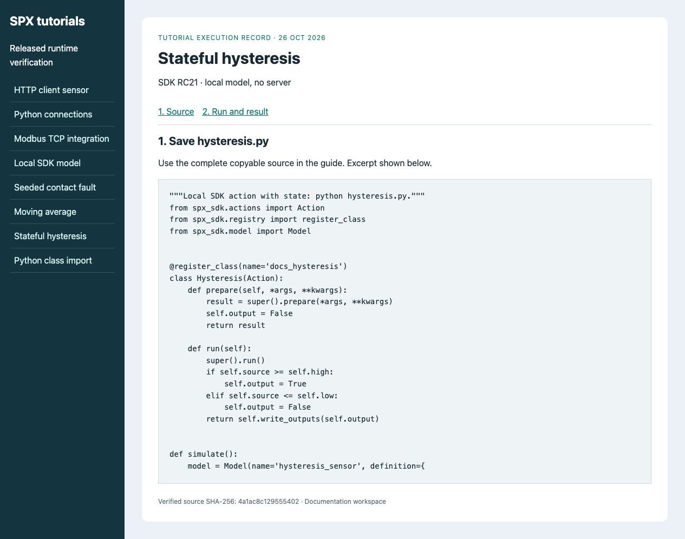
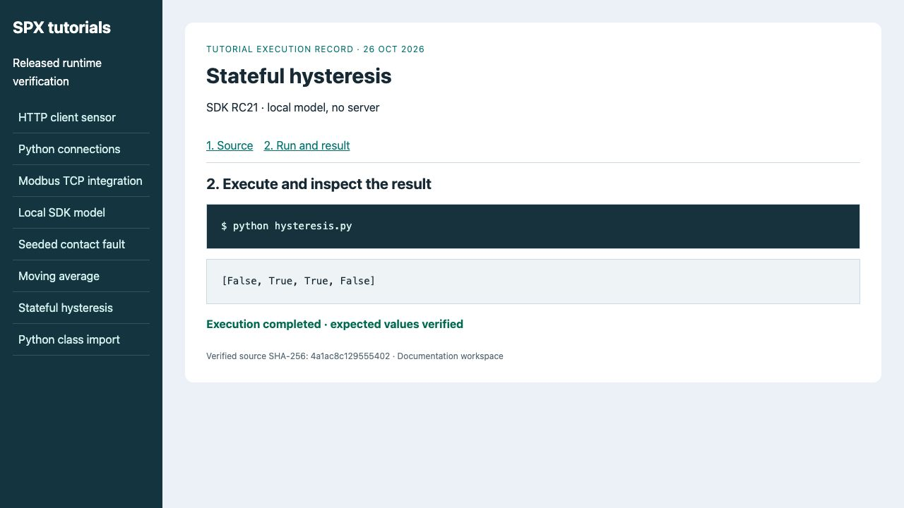

# Custom actions and logic

**Goal:** cooling output follows **false → true → true → false** for temperature
inputs **20 → 23 → 21 → 17°C**.
**Before you start:** the [SDK environment](../../spx-development-guide/quick-start-spx-sdk-in-5-minutes.md).
This is a complete local example with no server or key.

## 1. Save the action

Save as **hysteresis.py**. At or above 22°C cooling turns on; at or below 18°C
it turns off. Between thresholds it retains its previous state. Prepare resets
the action's state for a new experiment.
<figure><figcaption><p>The middle 21°C sample checks retained state, not just a threshold comparison.</p></figcaption></figure>
<!-- tutorial:hysteresis.py:start -->
```python
"""Local SDK action with state: python hysteresis.py."""
from spx_sdk.actions import Action
from spx_sdk.registry import register_class
from spx_sdk.model import Model


@register_class(name='docs_hysteresis')
class Hysteresis(Action):
    def prepare(self, *args, **kwargs):
        result = super().prepare(*args, **kwargs)
        self.output = False
        return result

    def run(self):
        super().run()
        if self.source >= self.high:
            self.output = True
        elif self.source <= self.low:
            self.output = False
        return self.write_outputs(self.output)


def simulate():
    model = Model(name='hysteresis_sensor', definition={
        'attributes': {'k__temperature_c': 20.0, 'cooling_on': False},
        'actions': [{'docs_hysteresis': '$out(cooling_on)',
                     'source': '$in(k__temperature_c)', 'low': 18.0, 'high': 22.0}],
    })
    try:
        model.prepare()
        result = []
        for tick, temperature in enumerate((20.0, 23.0, 21.0, 17.0)):
            model['timer']['time'] = tick / 10
            model['attributes']['k__temperature_c'].internal_value = temperature
            model.run()
            result.append(model['attributes']['cooling_on'].external_value)
        assert result == [False, True, True, False], result
        return result
    finally:
        model.destroy()


if __name__ == '__main__':
    print(simulate())
```
<!-- tutorial:hysteresis.py:end -->

## 2. Execute and check

```bash
python hysteresis.py
```

```text
[False, True, True, False]
```

<figure><figcaption><p>The assertion checks both transitions and the state retained inside the band.</p></figcaption></figure>

**Completion:** the assertion passes; the finally block destroys the model.
Call `super().run()` before reading dynamic source/threshold parameters, then
use `write_outputs` to publish the result. Keep state on the action instance.

For a stochastic presentation effect see [Write a custom action](../../getting-started/extend-with-custom-component.md).
For installation into a server see [Test and reload extensions](testing-and-hot-reload.md).
