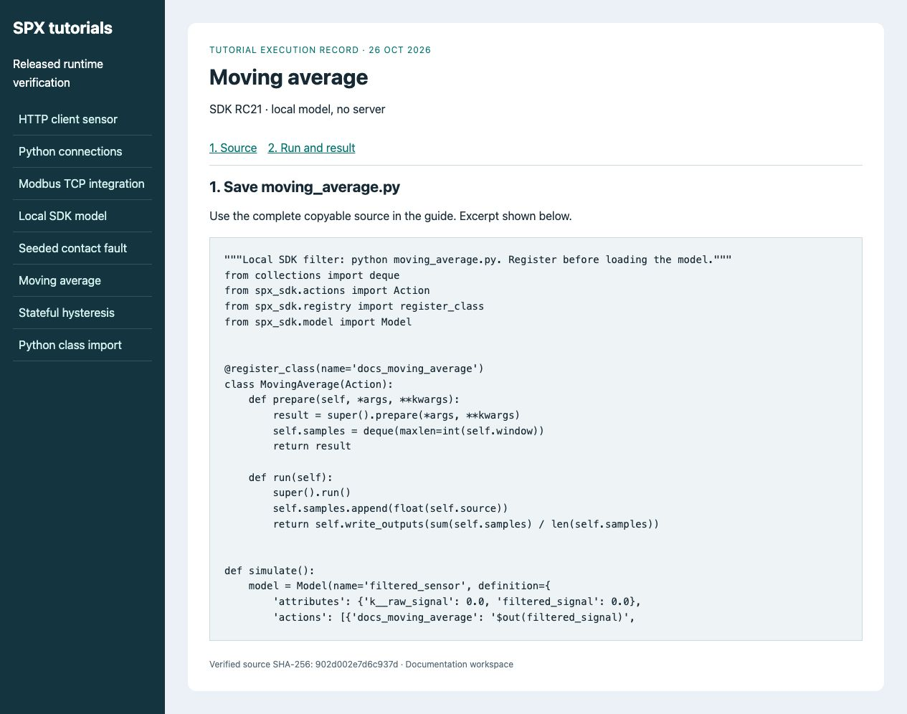
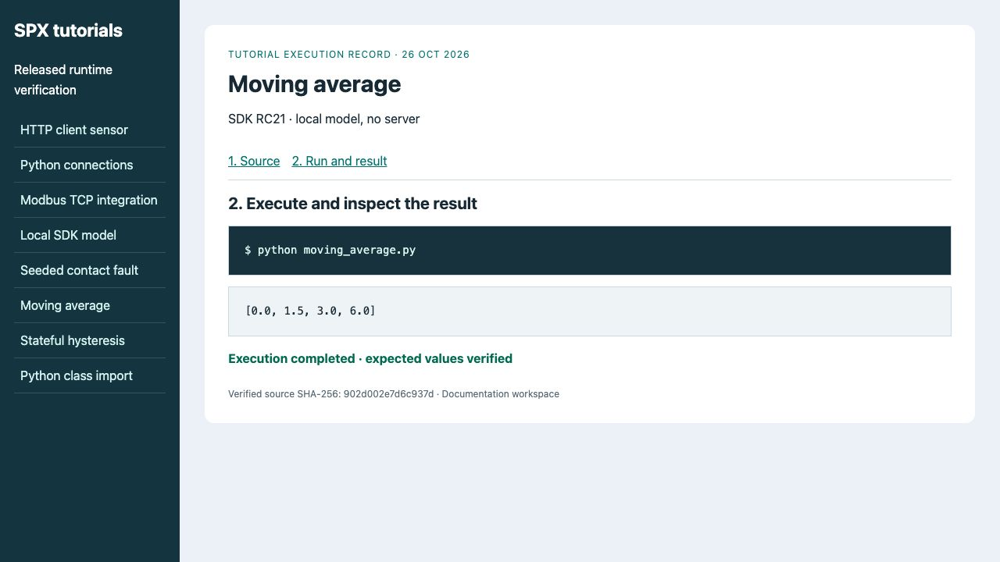

# Test and reload extensions

**Goal:** reproduce the extension's expected outputs from a fresh model and
verify a newly created server instance uses the intended code.
**Before you start:** complete [Filter a signal](filters-and-signal-processing.md)
or [Write a custom action](../../getting-started/extend-with-custom-component.md).
Keep local SDK execution separate from server module installation.

## 1. Prove the local behavior first

Run the complete local script in a fresh Python process after each edit:

```bash
python moving_average.py
```

Expected output is **[0.0, 1.5, 3.0, 6.0]**. The script prepares fresh filter
state and checks its output before destroying the model.
<figure><figcaption><p>Start from the complete source used in the filter guide.</p></figcaption></figure>
<figure><figcaption><p>This verifies the local extension. The following steps additionally verify server installation.</p></figcaption></figure>

## 2. Install the module where the server can load it

Place the extension in the server's configured extension directory or mounted
container directory. The client working directory is not the server filesystem.
Install any required dependencies in the server environment. Do not upload code
to a shared runtime merely to try an introductory example.

For a project-owned Compose deployment, use its mounted extension directory.
For an installed workspace, use its supported extension configuration; public
Examples itself is not the product's Compose deployment.

## 3. Request module reload and recreate the demo instance

On the disposable server use the HTTP client:

```python
import os
import spx_python

client = spx_python.init(
    address=os.environ.get('SPX_BASE_URL', 'http://localhost:8000'),
    product_key=os.environ['SPX_PRODUCT_KEY'],
)
client.reload_modules()
```

Reload scans the configured server directories. Existing instances can retain
old class/state bindings. Stop and remove only the demo instance, then register
the intended model definition and create a fresh instance. Follow the
[client lifecycle](../using-spx-python.md) for prepare, manual stepping and cleanup.
If a module remains cached, restart the disposable server through its deployment
controls, reconnect, recreate the instance and repeat the check.

## 4. Verify the actual runtime result

Supply the filter inputs **0, 3, 6, 9** in order, running one cycle after each.
Read `filtered_signal` after each cycle; require **0, 1.5, 3, 6**. For the same
inspection controls see [Instances UI](../../ui-reference/instances.md).
A successful reload request alone does not prove that an instance uses new code.

Keep the module revision, inputs and results with the test record. Stop and
remove the demo instance/model afterwards. An unknown action name usually means
an import failure, wrong directory or missing dependency; inspect server logs.
Protocol access must be checked separately when the task requires it.
