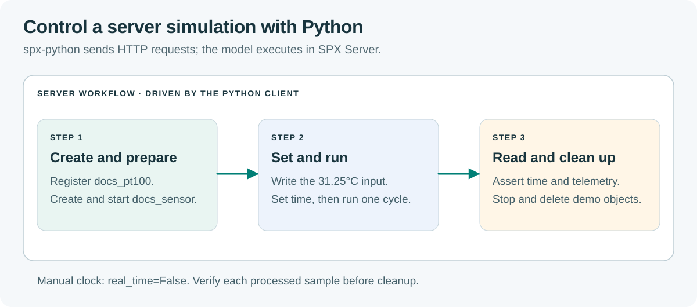

# Using spx-python for Simulation

`spx-python` RC3 is an HTTP client. It controls a running SPX Server; it does
not execute the model locally like `spx_sdk.model.Model`.

## Prerequisites

Use Python 3.12 and a disposable SPX Server RC76 with the
[documented bundle versions](../release-notes.md). [Install SPX](../getting-started/installation-guide.md)
and start it with **SPX Start** before running this program. Check that
`http://localhost:8000/health` reports `status: ok`.
Use a server without other users' simulations for this exercise.
For managed workspaces use [MCP onboarding](../getting-started/connect-llm-with-spx-mcp.md);
do not replace the workspace's private connection binding with a guessed `.env`.

## Prepare a working directory

Open a terminal and choose the commands for your shell. They create a new
`spx-python-demo` directory and install the client into its own virtual environment.
If `python3.12` or `py -3.12` is unavailable, install Python 3.12 first.

### macOS/Linux

```bash
mkdir spx-python-demo
cd spx-python-demo
python3.12 -m venv .venv
. .venv/bin/activate
python -m pip install spx-python==1.0.0rc3
```

### Windows PowerShell

```powershell
mkdir spx-python-demo
cd spx-python-demo
py -3.12 -m venv .venv
.\.venv\Scripts\Activate.ps1
python -m pip install spx-python==1.0.0rc3
```

If your organization's policy blocks activation, use
`.\.venv\Scripts\python.exe` instead of `python` in the installation and run
commands. For example: `.\.venv\Scripts\python.exe client_sensor.py`.

## Set your connection

In the same terminal, replace `REPLACE_WITH_YOUR_PRODUCT_KEY` with the key used
by your SPX installation. Keep the key out of the program and screenshots.
These values apply to this terminal session; the program reads them from the
environment rather than loading a `.env` file.

macOS/Linux:

```bash
export SPX_PRODUCT_KEY='REPLACE_WITH_YOUR_PRODUCT_KEY'
export SPX_BASE_URL='http://localhost:8000'
```

Windows PowerShell:

```powershell
$env:SPX_PRODUCT_KEY = 'REPLACE_WITH_YOUR_PRODUCT_KEY'
$env:SPX_BASE_URL = 'http://localhost:8000'
```

Use your actual API address if it differs. A successful public health check
confirms that the server is reachable; the program also needs an accepted key.

<figure><figcaption><p>The Python client controls the server; each explicit cycle processes the current input before telemetry is read.</p></figcaption></figure>

## Complete program

Save as `client_sensor.py` in `spx-python-demo`, then run it from the terminal
prepared above:

```bash
python client_sensor.py
```

It creates a model and instance with reserved demo
names, refuses to overwrite existing objects, then stops and deletes only the
objects it created. Expected output:

```text
[(0.0, 31.25), (0.1, 31.25), (0.2, 31.25)]
```

<!-- tutorial:client_sensor.py:start -->
```python
"""Use a disposable server: this creates and removes docs_pt100/docs_sensor."""
import os
import spx_python

DEFINITION = {
    'name': 'docs_pt100',
    'attributes': {
        'k__temperature_c': {'type': 'float', 'default': 20.0, 'unit': 'degC'},
        'temperature_c': {'type': 'float', 'default': 20.0, 'unit': 'degC'},
    },
    'actions': [{'function': '$in(temperature_c)', 'call': '$in(k__temperature_c)'}],
}


def simulate(client):
    # Refuse to replace a user's existing model or instance.
    if 'docs_pt100' in client['models'] or 'docs_sensor' in client['instances']:
        raise RuntimeError('docs_pt100/docs_sensor already exists; use a disposable server')
    client['models']['docs_pt100'] = DEFINITION
    try:
        client['instances']['docs_sensor'] = 'docs_pt100'
        inst = client['instances']['docs_sensor']
        inst.real_time = False
        inst.prepare()
        inst.start()
        assert inst.state == 'RUNNING', inst.state
        inst['attributes']['k__temperature_c'].internal_value = 31.25
        rows = []
        for tick in range(3):
            # HTTP proxy: set the property, not inst['timer']['time'].
            inst['timer'].time = tick / 10
            inst.run(time_step=0.1)
            rows.append((inst['timer'].time,
                         inst['attributes']['temperature_c'].external_value))
        return rows
    finally:
        if 'docs_sensor' in client['instances']:
            client['instances']['docs_sensor'].stop()
            del client['instances']['docs_sensor']
        del client['models']['docs_pt100']


if __name__ == '__main__':
    client = spx_python.init(
        address=os.environ.get('SPX_BASE_URL', 'http://localhost:8000'),
        product_key=os.environ['SPX_PRODUCT_KEY'],
    )
    print(simulate(client))
```
<!-- tutorial:client_sensor.py:end -->

If Python reports `ModuleNotFoundError: spx_python`, use the virtual environment's
interpreter. For `KeyError: SPX_PRODUCT_KEY`, set the connection values in the
same terminal that runs the program. For connection or authorization errors,
check SPX Start, the API address and the installation's product key.

## Clock and lifecycle contract

- `real_time = False` prevents automatic model polling. Prepare once, then start
  the model before stepping. Do not prepare the whole system on every iteration.
- The HTTP proxy writes the timer property with `inst["timer"].time = t`.
  `inst["timer"]["time"] = t` is not the supported proxy property setter.
- An absolute time write suppresses the next automatic increment: the next
  explicit `run(time_step=0.1)` evaluates at that assigned time. A subsequent
  step without another absolute write advances it by 0.1.
- A single explicit run while a runtime model is paused executes one admitted
  cycle and leaves it `PAUSED`; `start()` resumes it. SDK base components have
  different lifecycle details; see [lifecycle reference](../spx-development-guide/spx-sdk/components/spxcomponent.md).
- Check the actual clock and output, not just a successful request or `RUNNING`.

## Values, faults and connections

Read telemetry via `external_value`; write persistent simulation inputs through
the appropriate `k__*` attribute. An internal write clears an external override.
For a persistent fault, apply it after the model's internal update on each
relevant cycle, or implement a fault action in the model.

For instance-to-instance wiring use the [connections reference](../spx-core/system/connections.md).
An agent should prefer the structured MCP connection tools described in the
[MCP reference](../getting-started/mcp-reference.md).

## Repeatability and tests

A manual clock alone does not fix random numbers, network delivery or external
process scheduling. Pin definitions and versions, seed local random generators,
and assert expected values. [Custom actions](../getting-started/extend-with-custom-component.md)
show a generator isolated per instance. Snapshot import restores structure;
reapply test inputs explicitly after import.

Run server integration tests only when the configured test server and key are
available; a skipped integration test is not a passing runtime verification.

Each output tuple is `(simulation_time_s, temperature_c)`. Require the three
reported times and 31.25°C readings shown above. The program removes its demo
resources before returning these samples.

Continue with [Python connections](../guides/python-connections.md), or perform the [same task in the UI](../guides/ui-instance.md).
