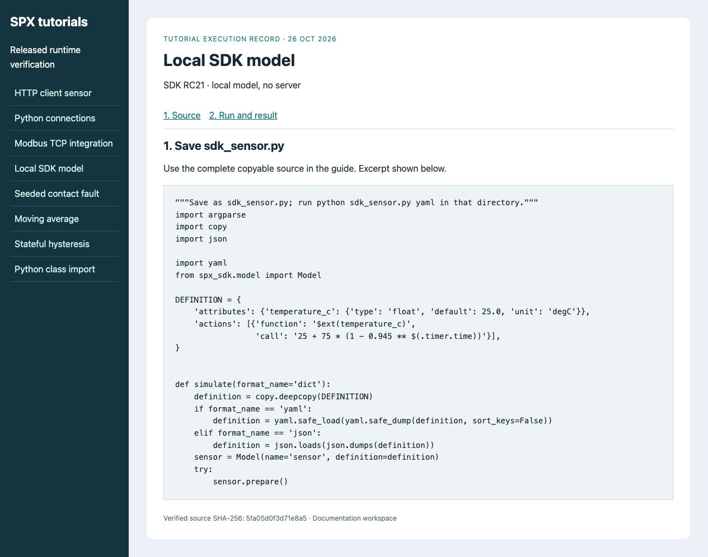
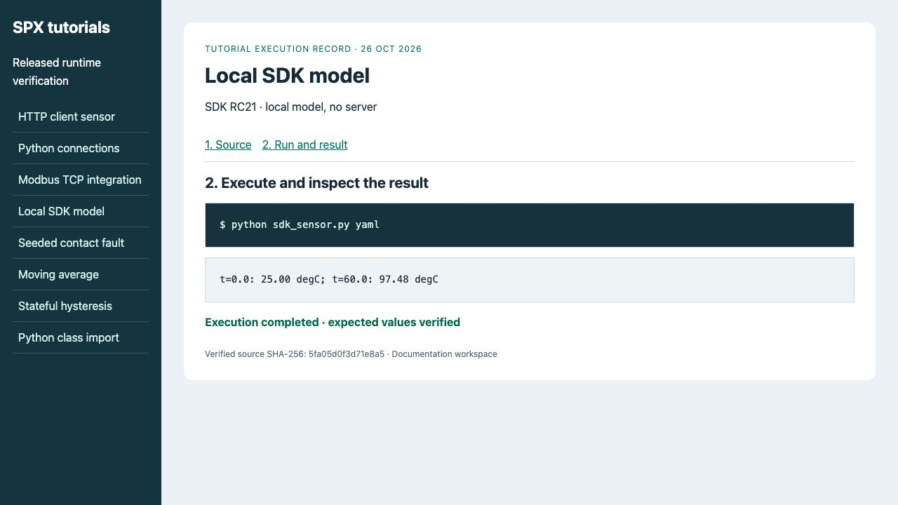

# Local model with SDK

Run a local SDK model without Docker, a server or a product key. This is the
SDK RC21 workflow; HTTP client/runtime examples use a different timer interface.
See the [version matrix](../overview/system-requirements-and-capability.md).

## Prepare a working directory

Use Python 3.12 and choose the commands for your shell. Work in a new directory.

### macOS/Linux (POSIX shell)

```bash
mkdir spx-sdk-demo
cd spx-sdk-demo
python3.12 -m venv .venv
. .venv/bin/activate
python -m pip install spx-sdk==1.0.0rc21 PyYAML==6.0.3
```

### Windows PowerShell

```powershell
mkdir spx-sdk-demo
cd spx-sdk-demo
py -3.12 -m venv .venv
.\.venv\Scripts\Activate.ps1
python -m pip install spx-sdk==1.0.0rc21 PyYAML==6.0.3
```

If your organization's policy does not allow activation scripts, run commands
with `.\.venv\Scripts\python.exe` directly instead of changing execution policy.
For example: `.\.venv\Scripts\python.exe sdk_sensor.py yaml`.

Do not clone the private SDK repository to follow this public tutorial.
The package metadata allows Python >=3.9,<4; that is not a claim that the full
SPX Server or public Examples works on every such version.

<figure><figcaption><p>The local model needs only the SDK environment; no server connection is involved.</p></figcaption></figure>

## Run the sensor

Save the complete program below as `sdk_sensor.py` in your working directory.
It supports YAML, JSON and Python dict round-trips of the same definition.
Run each alternative:

```bash
python sdk_sensor.py yaml
python sdk_sensor.py json
python sdk_sensor.py dict
```

<!-- tutorial:sdk_sensor.py:start -->
```python
"""Save as sdk_sensor.py; run python sdk_sensor.py yaml in that directory."""
import argparse
import copy
import json

import yaml
from spx_sdk.model import Model

DEFINITION = {
    'attributes': {'temperature_c': {'type': 'float', 'default': 25.0, 'unit': 'degC'}},
    'actions': [{'function': '$ext(temperature_c)',
                 'call': '25 + 75 * (1 - 0.945 ** $(.timer.time))'}],
}


def simulate(format_name='dict'):
    definition = copy.deepcopy(DEFINITION)
    if format_name == 'yaml':
        definition = yaml.safe_load(yaml.safe_dump(definition, sort_keys=False))
    elif format_name == 'json':
        definition = json.loads(json.dumps(definition))
    sensor = Model(name='sensor', definition=definition)
    try:
        sensor.prepare()
        values = []
        for tick in range(601):
            seconds = tick / 10
            # Local SDK SimpleTimer: explicit absolute time, not the HTTP proxy.
            sensor['timer']['time'] = seconds
            sensor.run()
            values.append(sensor['attributes']['temperature_c'].external_value)
        return values
    finally:
        sensor.destroy()


if __name__ == '__main__':
    parser = argparse.ArgumentParser()
    parser.add_argument('format', choices=['yaml', 'json', 'dict'], default='dict', nargs='?')
    args = parser.parse_args()
    result = simulate(args.format)
    print(f't=0.0: {result[0]:.2f} degC; t=60.0: {result[-1]:.2f} degC')
```
<!-- tutorial:sdk_sensor.py:end -->

All variants print `t=0.0: 25.00 degC; t=60.0: 97.48 degC`.
`$ext` selects the external value wrapper; `$in` selects the internal wrapper.
Neither prefix by itself means read-only or write-only. The action's destination
and expression determine the operation. This example computes from absolute
simulated time and has no random inputs.

## Extend with a cooling action

Save this separate program as `heat_loss.py`, then run `python heat_loss.py`.
It prints `[92.0, 84.8, 78.32]`. The coefficient is a fraction per execution,
not a continuous-time physical rate. The decorator registers the class when
this module is imported; a server must import it before loading the definition.

<!-- tutorial:heat_loss.py:start -->
```python
"""Save as heat_loss.py; run python heat_loss.py in that directory."""
from spx_sdk.actions import Action
from spx_sdk.model import Model
from spx_sdk.registry import register_class


@register_class(name='docs_heat_loss')
class HeatLoss(Action):
    def run(self):
        super().run()  # Resolve dynamic parameters before reading them.
        temperature = self.temperature_c
        return self.write_outputs(temperature - self.k * (temperature - self.ambient_c))


def simulate():
    model = Model(name='cooling_sensor', definition={
        'attributes': {'temperature_c': {'type': 'float', 'default': 100.0, 'unit': 'degC'}},
        'actions': [{'docs_heat_loss': '$in(temperature_c)',
                     'temperature_c': '$in(temperature_c)', 'k': 0.1, 'ambient_c': 20.0}],
    })
    try:
        model.prepare()
        values = []
        for tick in range(3):
            model['timer']['time'] = float(tick)
            model.run()
            values.append(model['attributes']['temperature_c'].internal_value)
        return values
    finally:
        model.destroy()


if __name__ == '__main__':
    print(simulate())
```
<!-- tutorial:heat_loss.py:end -->

## Next steps and cleanup

- [Registry and class loading](spx-sdk/registry.md)
- [Actions](spx-sdk/actions.md)
- [SDK versus runtime model](spx-sdk/model.md)
- [HTTP client tutorial](../simulation-and-modeling/using-spx-python.md)

The programs destroy their local model trees. Deactivate the virtual environment
when finished; no server resources have been created.

<figure><figcaption><p>The three serialization formats produce the same verified curve.</p></figcaption></figure>

Continue with [Write a custom action](../getting-started/extend-with-custom-component.md) or return to [model development](../guides/modeling.md).
