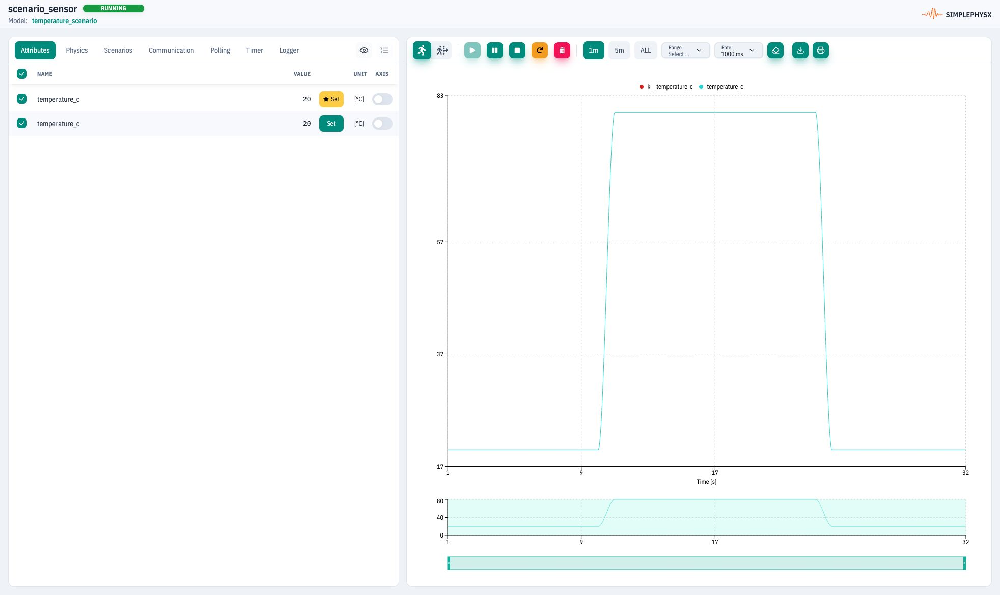

# Testing and Validation

<figure><figcaption><p>A complete check includes baseline, disturbance and the documented state after stopping.</p></figcaption></figure>


Testing is the quality gate for SPX models. Treat your model library like code: every change should be validated by a deterministic suite.

## Recommended layers

1. **MiL tests (pytest)**: drive SPX deterministically from Python and assert behavior end-to-end.
2. **Scenario checks**: cover multi-step sequences and fault transitions via Scenarios.
3. **Snapshot fixtures**: restore known-good starting states for stable regressions.

## Validation depends on the task

Repository changes require the relevant validator and tests. For an ephemeral
MCP request, follow the runtime workflow: register/recreate the model and stop
when the instance is RUNNING unless protocol proof or deeper diagnostics was
requested. A source review, an in-process test and a physical device test are
different levels of evidence; report which one you performed.

## Minimal CI-shaped loop

Run the following only from your own prepared Compose project. Public Examples
and Docs do not include a product Compose bundle; provision a stack first using
SPX Setup or the [server-only guide](getting-started/manual-docker-compose.md).


```bash
docker compose up -d
pytest
docker compose down
```

See:

- MiL tests: [Use in Unit Tests (MiL)](getting-started/use-in-unit-tests-mil.md)
- CI: [CI/CD Setup (GitHub Actions)](getting-started/ci-cd-setup-github-actions.md)
- Snapshots: [Snapshots — Getting Started](getting-started/snapshots-guide.md)
