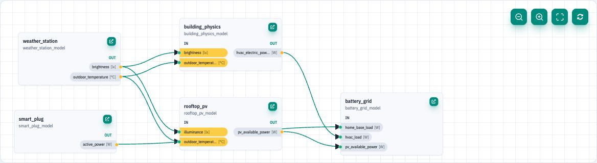

# Connections

## Purpose

The Connections view lets you wire data flow between instance attributes without editing model files. Use it to validate signal paths, mirror values, and quickly iterate on wiring during debugging.

Back to UI Overview: [UI Overview](general-view.md).

## Where to find it

In the UI navigation, select **Connections**.

## What you can do here

* Browse and search connections by name or endpoint.
* Create, edit, duplicate, or delete connections.
* Toggle connections on/off with the **Enabled** switch.
* Choose the **Internal** or **External** value slot (`internal_value` / `external_value`) for each endpoint. **From** and **To** define propagation direction; the slot selectors do not.
* Import/export full system configuration (models/instances/connections) and copy export data.

### Graph example: building energy balance

The graph below shows **five simulation instances and seven active connections**
in SPX UI RC76. It uses public Smart Building models with protocol adapters
removed, so the example runs without a broker, gateway or physical device.

<figure><figcaption><p>Five-instance building energy example in the real SPX UI. Yellow ports mark k__ control attributes; grey ports mark ordinary attributes. Arrows show source-to-target propagation. Node positions were arranged manually for this screenshot.</p></figcaption></figure>

| Instance | Role in the example |
| --- | --- |
| `weather_station` | Outdoor temperature and illuminance feed the building and PV models. |
| `building_physics` | Estimates envelope losses, solar/internal gains and HVAC electric demand. |
| `rooftop_pv` | Converts illuminance and ambient temperature into available PV power. |
| `smart_plug` | Represents a switched 1,500 W household load. |
| `battery_grid` | Combines loads and PV, then balances battery charge/discharge and grid import/export. |

Four weather connections carry `outdoor_temperature_c` and `brightness_lux` to
`building_physics.k__outdoor_temperature_c`, `building_physics.k__brightness_lux`,
`rooftop_pv.k__outdoor_temperature_c` and `rooftop_pv.k__illuminance_lux`.
Three power connections complete the balance, all in **watts**:

| From (External) | To (Internal) |
| --- | --- |
| `building_physics.hvac_electric_power_w` | `battery_grid.hvac_load_w` |
| `rooftop_pv.pv_available_power_w` | `battery_grid.pv_available_power_w` |
| `smart_plug.active_power_w` | `battery_grid.home_base_load_w` |

The ESS model checks the instantaneous electrical balance:

```text
pv_power_w + battery_power_w + grid_power_w = load_power_w
```

Positive battery power means **discharge**; negative means charging. Positive
grid power means **import**; negative means export. In this simplified example,
`load_power_w` contains the plug load and HVAC electricity; no EV load is added.
The building's thermal balance and HVAC conversion are estimated inside its
model, rather than by the graph itself. These are teaching models, not a
calibrated building energy assessment.

Use **Fit graph to view**, zoom controls and node dragging to explore the wiring.
Selecting a connection highlights its path and endpoints; the table is the
place to edit it. The `k__` prefix remains part of the actual attribute name even when the graph
displays a shorter label and unit.

**Try it:** [download the example bundle](../.gitbook/assets/building-energy-five-instances.zip),
extract the JSON file and use **Import configuration** in a disposable workspace
with capacity for five models and five instances. Export your current system
first: importing these sections replaces runtime configuration. Select models,
instances and connections; after import start all five instances and the
Connections container. The bundle includes its source revision and MIT license.
It restores configuration/defaults, not the screenshot's live readings or layout.

Lower the weather station's `k__brightness_lux` and confirm PV power falls; lower
`k__outdoor_temperature_c` and observe the building's HVAC response over time.
Inspect `battery_grid` to verify the power balance and battery/grid response.

### Connections list

The table is grouped into **From** and **To** endpoints. Each connection has:

* **Name** — a human-friendly connection identifier.
* **From** — instance + attribute + value source.
* **To** — instance + attribute + value source.
* **Enabled** — toggle to activate or disable the connection.

Value sources are shown as chips in the list; when you edit a row, they become **Internal/External** toggles. Choose the slot required by your model. In the example above, the source exposes telemetry through **External** and the target receives it through **Internal**.

<figure><figcaption><p>Connections list showing From/To columns + Enabled toggle</p></figcaption></figure>

### Create or edit a connection

Use **Add connection** to create a new row, then select instances and attributes. Use the **Internal/External** toggle in the Value column to choose which attribute value to read/write (`internal_value` vs `external_value`). Internal is the model's computed value; External is the value exposed to or coming from the outside. Save or cancel from the action buttons in the row; existing rows also support **Duplicate** and **Delete**.

<figure><figcaption><p>New connection row in edit mode</p></figcaption></figure>

### Import / Export configuration

Use **Import** or **Export** to move a full system configuration (models, instances, connections) between environments. You can also copy the export payload to the clipboard.

<figure><figcaption><p>Connections page import/export actions</p></figcaption></figure>

## Typical workflow

1. Open **Connections** and search for an existing connection (if needed).
2. Add or edit a connection and select **From** and **To** endpoints.
3. Choose **Internal** or **External** value sources and save.
4. Toggle **Enabled** on and confirm values change in **Instances**.

## What to verify

* Integrator: source and destination instances/attributes exist and update correctly.
* QA: connections are deterministic when stepping time in tests.
* Developer: enabling/disabling connections has immediate effect on values.

## Common issues

* Server connection not established: connect in **Settings** and refresh.
* Attribute list empty: select an instance first; verify the instance exposes attributes.
* Connection does not update values: confirm **Enabled** is on and endpoints are correct.
* Save fails: check for missing name, instance, or attribute.
