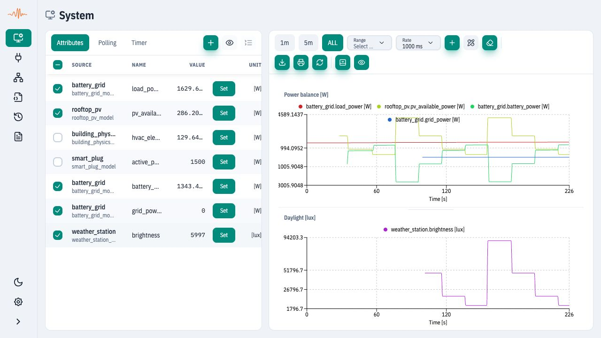
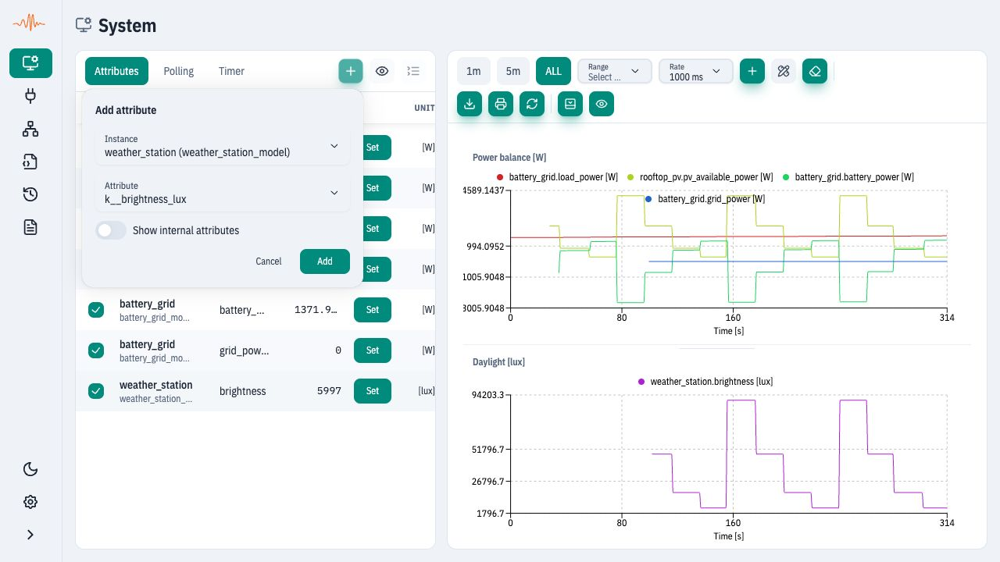

# System

Open **System** in the sidebar to compare signals from several running instances.
The left panel contains **Attributes**, **Polling** and **Timer** tabs; the right
panel displays the selected time series. Drag the divider to resize the panels.

Use [Connections](connections.md) to define data flow, **System** to observe its
effect, and [Instances](instances.md) to inspect or start one simulation. Adding
a signal to System does not create a connection or start an instance. For the
server's component hierarchy, see [System runtime](../spx-core/system/README.md).

## Example: observe the building energy graph

This uses the same [five-instance building energy example](connections.md#graph-example-building-energy-balance):
weather station, building physics, rooftop PV, smart plug and battery/grid.
Import its downloadable bundle into a disposable workspace and start its five
instances and Connections container before setting up this view.

<figure><figcaption>
Real SPX UI RC76, using the same protocol-free building energy fixture as Connections. Weather inputs change during collection. The table watches seven signals; five are plotted across two charts.
</figcaption></figure>

In **Attributes**, use **Add system attribute** (+) to select an instance and an
attribute. Repeat for the signals below; these are the actual runtime names,
even when the UI shortens a label or shows a separate unit.

| Instance | Attribute | Use in this view |
| --- | --- | --- |
| `battery_grid` | `load_power_w` | Total electrical load; Power balance chart. |
| `rooftop_pv` | `pv_available_power_w` | Available generation; Power balance chart. |
| `battery_grid` | `battery_power_w` | Discharge positive, charging negative; Power balance chart. |
| `battery_grid` | `grid_power_w` | Import positive, export negative; Power balance chart. |
| `building_physics` | `hvac_electric_power_w` | Watch HVAC demand in the table. |
| `smart_plug` | `active_power_w` | Watch the 1,500 W household load in the table. |
| `weather_station` | `brightness_lux` | Daylight chart on its own lux scale. |

Rename **Chart 1** to **Power balance [W]** by clicking its title. Use **Add chart**
to create **Daylight [lux]**, then choose it in the weather row's **Chart** field.
Uncheck the HVAC and plug rows to keep their values in the table without adding
two more curves. Keep watts and lux on separate charts instead of sharing one
scale. Horizontal scrolling reveals table columns that do not fit the panel.

To reproduce the changing curves without leaving System, add
`weather_station.k__brightness_lux` as an extra, unchecked watchlist row and use
**Set**, for example 48,000 → 18,000 → 6,000 → 90,000 lux. Alternatively, keep
System open and edit the input in [Instances](instances.md) in a second browser
tab connected to the same server. Allow time for the models, connections and
UI refresh after each edit. PV output should follow the daylight change, and
the ESS should change battery/grid power while satisfying the
[electrical balance](connections.md#graph-example-building-energy-balance).
These are simplified teaching models, not a calibrated building assessment.

## Add, inspect and edit signals

<figure><figcaption>
Select the runtime instance first, then its attribute. Adding it only changes the watchlist; it does not write a value.
</figcaption></figure>

| Control | Effect |
| --- | --- |
| Add system attribute | Adds a runtime attribute to the watchlist. **Show internal attributes** in this popover also lists helper attributes whose names begin with `_`. |
| Row checkbox | Shows or hides that signal on a chart; it remains in the watchlist. |
| Value and unit | Shows the latest sampled value, preferring the exposed External slot and falling back to Internal when needed. |
| Set | Writes the attribute's **Internal** slot. Prefer a model's `k__` control inputs; a calculated value may be overwritten on the next model cycle. |
| Chart | Assigns the signal to one of the named chart panels. |
| Axis | Gives the signal its own scale; it does not convert units or change the model. |
| Hide / Show hidden attributes | Hides a watchlist row and lets you reveal it later. This differs from listing `_` helper attributes in the Add popover. |
| Remove | Removes the signal from this view, without deleting the runtime attribute or instance. |

## Charts and collected history

Use **1m**, **5m**, **ALL** or **Range** to choose the displayed time interval.
**Rate** sets how often this view reads values from the server. The brush below
the charts adjusts the visible interval; it can be minimized or hidden. With
multiple charts, **Edit chart layout** enables reordering, and panel dividers
adjust their relative heights.

**Chart time** (`Time [s]`) is browser elapsed time since this view began collecting
data. It is not the simulation clock. A flat trace with an advancing chart axis
can mean an unchanged input, a stopped instance, or inactive propagation; inspect
the actual instance and connection states before drawing a conclusion.

**Refresh values** requests another sample. **Clear chart data** clears this
view's collected history and restarts its chart time; it does not reset the
simulation. **Export CSV** downloads the plotted series for the chart interval;
choose **ALL** if you want the full collected interval. **Print** opens the browser
print flow for the charts.

History is collected while this view is open, not backfilled from a server
historian. A signal added later has no earlier samples, so early CSV cells may
be empty. Watchlist/chart settings are remembered in this browser; reloading or leaving this view does
not preserve its collected history. A [snapshot](snapshots.md) restores runtime
configuration, not these chart samples. UI sampling is also not an atomic
measurement across instances; use controlled tests for strict timing assertions.

## Timer and Polling tabs

These tabs inspect the **system-level** timer and polling entities as attribute
trees. They show current fields and permit edits where the server exposes a
setter. They do not replace the Timer and Polling tabs of individual instances.

Three mechanisms are separate: chart **Rate** controls UI reads, runtime
**Polling** schedules model cycles, and a runtime **Timer** tracks simulation
time. Changing the chart rate does not change either runtime mechanism. See
[Timer & Polling in the UI](timer-and-polling.md) for screenshots and fields.

## If the view is empty or values do not move

- No signals: use **Add system attribute** and select existing runtime attributes.
- Empty chart with populated rows: check row selection, chart assignment and range.
- Static values: check instance state, model inputs and connection propagation;
  faster chart refresh alone cannot make the simulation advance.
- Wrong-looking scale: check units and separate unrelated quantities into charts.
- Runtime import/replacement: recheck that watched instance/attribute names still
  exist. Use the [Connections example](connections.md#graph-example-building-energy-balance)
  to verify the expected wiring.

For the complete exercise, follow [Observe signals and test behavior](../guides/ui-observe.md).
