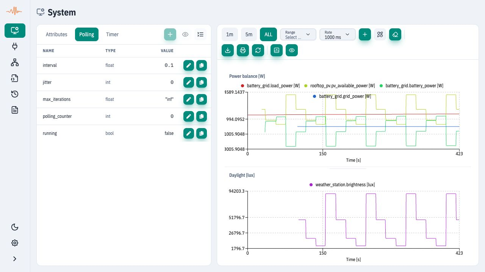
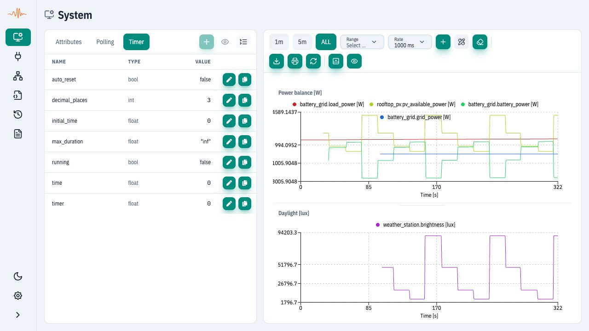

# Timer & Polling

## Purpose

The Timer and Polling tabs inspect runtime clock and execution settings. They
are different from the chart refresh **Rate** in [System](system.md). For
deterministic stepping from test code, see [Use in Unit Tests (MiL)](../getting-started/use-in-unit-tests-mil.md).

Back to UI Overview: [UI Overview](general-view.md).

## Where to find it

Open **System** in the sidebar, then select **Timer** or **Polling** in the left
panel. They are tabs, not separate sidebar entries in UI RC76. An individual
instance also has its own Timer and Polling tabs in [instance details](instances.md).
Always check which scope you are inspecting.

## What you can do here

### Polling view

The **System → Polling** tab shows the system polling entity as an attribute
tree. Typical fields include `interval` (seconds), `jitter`, `max_iterations`,
`polling_counter` and `running`. Runtime polling schedules model cycles; changing
the chart's Rate only changes how often the browser reads values.

<figure><figcaption>
System-level Polling in the same five-instance building energy example. Instance execution and chart sampling are separate from this system polling entity.
</figcaption></figure>

* Inspect top-level and nested polling attributes.
* Update only fields with an edit control, then confirm the effect in the relevant
  instance or logs. A running instance can use its own execution settings; this
  system tree alone does not prove whether each instance is advancing.

### Timer view

The **System → Timer** tab shows the system timer tree, including fields such as
`time`, `initial_time`, `max_duration`, `auto_reset`, `decimal_places` and `running`.
These are runtime timer fields, not the `Time [s]` axis collected by the browser.

<figure><figcaption>
System-level Timer, with the observation charts kept on screen. For one device's simulation clock, inspect that instance's Timer tab.
</figcaption></figure>

* Inspect timer attributes and nested values.
* Edit only fields where an edit control is present. Changing a system timer
  value is not a substitute for explicitly stepping a particular instance in a test.

Runtime definitions: [Polling](../spx-core/system/polling.md) and
[Timer](../spx-core/system/timer.md).

## Typical workflow

1. Open **System → Polling** and confirm the attribute tree loads.
2. Expand nodes and note current values.
3. Select **Timer** and confirm the system timer tree loads.
4. For a device-specific problem, open that instance's matching tabs before
   changing values. Record the scope and the field you changed.

## What to verify

* Integrator: the selected timer/polling entity belongs to the intended scope.
* QA: deterministic tests explicitly advance the appropriate instance clock.
* Developer: runtime polling cadence and chart refresh are treated separately.

## Common issues

* No timer available: the server does not expose timer data for this stack.
* No polling available: polling data is not exposed for this stack.
* Values cannot be edited: the attribute is read-only (no setter).
* UI time differs from tests: confirm both point to the same server.
* Charts change while the system timer appears stopped: inspect instance clocks
  and execution settings; chart time is browser elapsed time, not system timer time.
